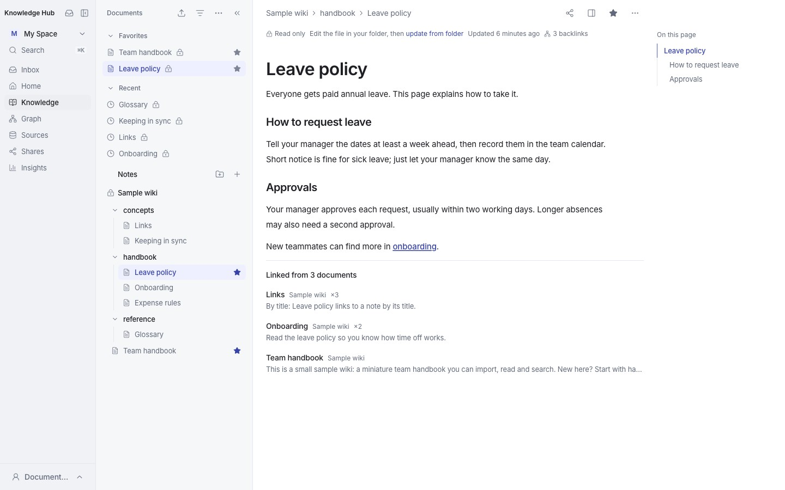
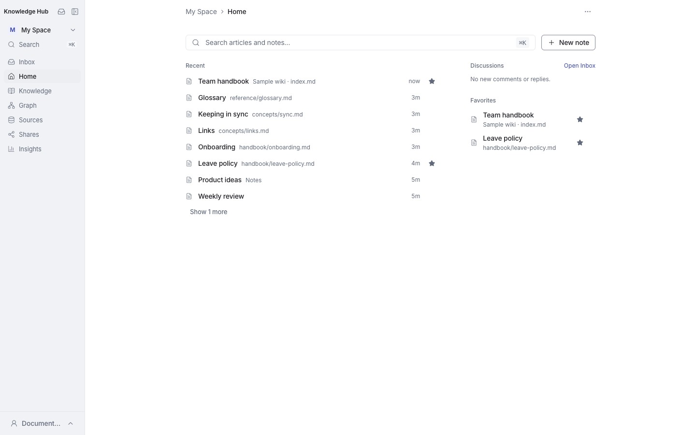
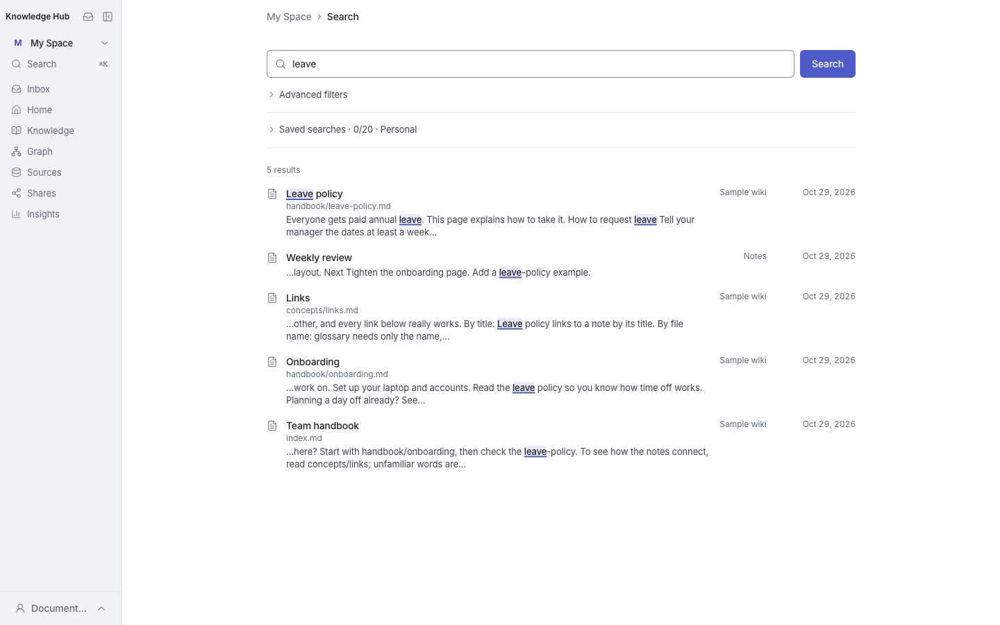
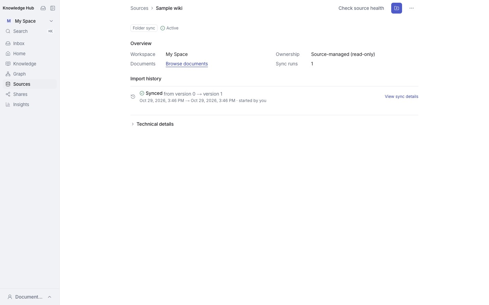
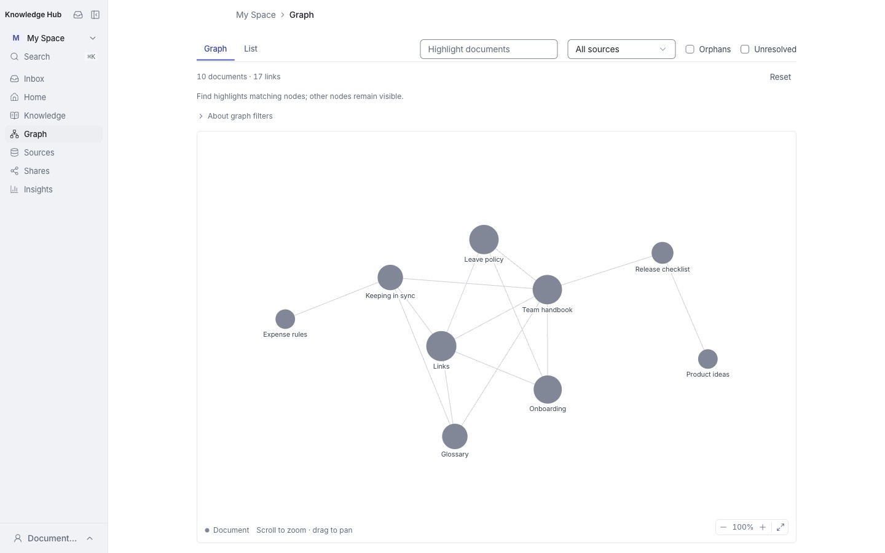

<div align="center">

<h1>
  <picture>
    <source media="(prefers-color-scheme: dark)" srcset="docs/images/banner-dark.svg">
    
  </picture>
</h1>

**將 Markdown 筆記變成可閱讀、可連結、可分享的知識空間。**

[](https://github.com/mike840609/knowledge-hub/actions/workflows/phase2-dev-gate.yml)
[](LICENSE)
[](package.json)
[](package.json)
<br>
[](https://nextjs.org)
[](https://react.dev)
[](https://www.typescriptlang.org)
[](https://mariadb.org)
[](https://tailwindcss.com)

[English](README.md) · **繁體中文**

[快速開始](#快速開始) · [功能](#功能) · [設定](#設定) · [部署](#部署) · [開發](#開發與測試) · [參與貢獻](CONTRIBUTING.zh-TW.md)

<br>



<sub>文件閱讀頁：文件瀏覽器、頁內大綱、已解析 wikilinks、反向連結，並清楚標示同步來源的唯讀狀態。</sub>

</div>

---

Knowledge Hub 是開源、可自行部署的知識工作空間。你可以直接在瀏覽器撰寫筆記，也可以匯入既有的 Markdown folder／LLM Wiki，透過搜尋、雙向連結與圖譜探索內容，在分享文件上討論，並匯出需要的內容。

內容始終是純 Markdown，不需要綁定特定筆記軟體、Wiki generator 或外部知識平台。

> [!NOTE]
> 目前版本為 **0.1.0，持續開發中**。預設提供個人工作空間 **My Space**；Team workspace 的導覽與存取預設關閉，可由管理者開啟。開發模式使用本機示範身分，正式部署必須整合可信任的身分提供者，詳見[部署](#部署)。

## 特色

- **Markdown 進、Markdown 出**：以可檢查的 Preview → Apply 流程匯入資料夾，可匯出單篇或整個 My Space ZIP。
- **知識互相連結**：`[[wikilink]]`、相對 `.md` 連結、反向連結，以及 Workspace／Local graph。
- **快速檢索**：Workspace 搜尋支援來源、路徑與日期篩選，並有 `⌘K`／`Ctrl+K` 指令面板。
- **分享與討論**：文件、資料夾與來源皆可建立可到期、可撤銷的唯讀連結，並在段落上討論。
- **為 Agent 準備**：Copy for Agent，以及與網頁版遵循相同存取規則的範圍化讀取 API。
- **自行部署**：Next.js server 加 MariaDB，由你掌控與擁有。

## 介面預覽

<table>
  <tr>
    <td width="50%" valign="top">
      
      <p><b>個人首頁</b>：集中草稿、最近文件、討論與收藏，Search 與 New note 就在手邊。</p>
    </td>
    <td width="50%" valign="top">
      
      <p><b>搜尋</b>：搜尋整個工作空間，並依來源、路徑與更新日期縮小範圍。</p>
    </td>
  </tr>
  <tr>
    <td width="50%" valign="top">
      
      <p><b>來源與同步歷史</b>：查看資料夾的來源管理方式與同步紀錄，再由 <b>Update from folder</b> 重新選取來源資料夾並檢查變更。來源可整個分享為一個連結，且不會公開其設定、歷史或資產。</p>
    </td>
    <td width="50%" valign="top">
      
      <p><b>知識圖譜</b>：探索文件間的連結、查找筆記，並依來源或未解析目標篩選。</p>
    </td>
  </tr>
</table>

<sub>截圖於 2026 年 10 月 29 日（Asia/Taipei）從 commit <a href="https://github.com/mike840609/knowledge-hub/commit/ba699b4e37ed5fdc22f3633e468aff6ef5a1704d"><code>ba699b4e</code></a> 的 production build 以 1440 × 900 擷取，使用展示帳號、內附英文 sample wiki 與合成筆記。視窗窄於 1280px 時文件瀏覽器改為抽屜，窄於 1024px 時導覽移入 Menu 抽屜。詳見<a href="docs/images/README.md">截圖來源紀錄</a>。</sub>

## 功能

| 功能 | 說明 |
| --- | --- |
| **個人工作空間** | My Space、Home、Inbox、個人筆記、草稿、收藏與最近閱讀；最近閱讀保留於裝置 |
| **Inbox** | 未讀更新與活動；視窗夠寬時，選取的討論會顯示在列表旁，可直接回覆、解決與隱藏 |
| **Markdown 編輯** | 渲染式編輯與 Markdown 原始碼模式、slash 插入、表格、toggle、callout、程式碼區塊、文件大綱與鍵盤快捷鍵 |
| **草稿與版本** | 帳號草稿自動保存、失敗時本機恢復副本、不可變版本歷史、版本比較與還原、過期編輯衝突檢查 |
| **匯入與同步** | Markdown folder 經 Preview → Apply 匯入；再次選取來源資料夾檢查後續變更；可排除路徑、查看來源健康與重新命名來源 |
| **文件整理** | 文件／資料夾樹、移動、更名、封存與還原；來源管理的內容在 Hub 內為唯讀 |
| **搜尋與檢索** | Workspace 搜尋，支援來源、路徑與日期篩選；`⌘K`／`Ctrl+K` 快速搜尋與最近文件；可儲存搜尋 |
| **知識連結** | `[[wikilink]]`、相對 `.md` 連結、Backlinks、Workspace／Local graph |
| **討論** | 擁有者在段落旁討論、分享頁留言、回覆、解決與隱藏、未讀通知與追蹤中的討論 |
| **分享** | My Space 匿名唯讀文件連結，可設期限與撤銷；只限指定已登入人員開啟的永久連結；收件者可將分享存到 Shares；擁有者可管理與隱藏留言 |
| **匯出** | 單篇 Markdown 下載、My Space ZIP 匯出，保留目錄與穩定 ID/path manifest |
| **Agent context** | Copy for Agent 與 Workspace 範圍的讀取／context API，沿用應用存取規則並包含討論 |
| **Team workspace** *（需開啟）* | Workspace 管理、membership、角色與能力、外部群組映射及 audit |

### 內容由誰管理？

- **Folder Sync（`SOURCE_MANAGED`）**：原始資料夾是內容來源。請在原始 Markdown 檔案修改，再重新產生 Preview 並 Apply。Hub 不直接編輯同步內容，也不會在背景自動監控你的本機資料夾。
- **Web Create／單篇 Upload（`HUB_MANAGED`）**：匯入或建立後由 Hub 管理，可在瀏覽器編輯，儲存時建立新 revision。

Preview 是固定的 staged snapshot。阻擋性診斷必須先處理；若來源版本已變更，Apply 會回傳衝突，需重新產生 Preview。

### 目前限制與未來方向

- 資產目前只儲存 metadata／reference，尚無附件 binary 儲存服務；本機圖片與附件不保證能在線上開啟。
- ZIP 匯出包含封存文件的最新已存版本，不包含草稿、版本歷史或附件 bytes；上限 64 MiB／9,999 份文件。
- 文件以封存／還原管理生命週期，沒有一般使用者的永久刪除流程。
- 搜尋目前以關鍵字為主。MCP server、semantic／hybrid retrieval 與進階 Agent memory 是未來方向，並非現有功能。
- Team 預設顯示 **Coming soon**。開啟開關不等於完成正式部署的身分整合。
- 討論寫入由 `KM_REVIEW_WRITES_ENABLED` 另外控制；關閉時仍可讀取既有討論及由擁有者管理留言。
- 隱藏討論不等同實際刪除已儲存的資料。

## 快速開始

### 前置需求

| 需求 | 說明 |
| --- | --- |
| Node.js **≥ 20.19.0、< 25** | [`.node-version`](.node-version) 指定 24.19.0 |
| pnpm 12 | 本機開發預設；npm 為備援（見[本機 pnpm](docs/development/maintainers.zh-TW.md#本機-pnpm)） |
| Docker + Compose v2 | 需支援 `up --wait`；用來執行 MariaDB 10.11 |
| `make`、Git | 沒有 `make` 時使用下方步驟 |

```bash
git clone https://github.com/mike840609/knowledge-hub.git
cd knowledge-hub
make bootstrap
make dev
```

開啟 **http://127.0.0.1:3000/**，進入 My Space。

`make bootstrap` 會在偵測到 pnpm 12 時使用 pnpm，否則退回 `npm ci`。它會安裝依賴、在 `.env` 不存在時複製 `.env.example`（既有 `.env` 會保留）、啟動資料庫、執行 migration 並載入開發 fixtures。範例資料庫憑證只供本機開發。

<details>
<summary><b>不使用 make</b></summary>

```bash
pnpm install
cp .env.example .env  # 首次設定；已有 .env 時請保留並檢查內容
docker compose up -d --wait mariadb
pnpm run db:migrate
pnpm run db:seed
pnpm run dev
```

若 pnpm 無法使用，請改用 `rm -rf node_modules .next && npm ci` 取代 `pnpm install`。

</details>

### 第一次使用

1. 選擇 **New note** 建立筆記，或 **Import folder** 匯入 Markdown 資料夾。匯入頁面附有資料夾格式指南，也提供 **Try with a sample wiki**：可匯入一份現成的資料夾（英文或繁體中文，位於 `public/sample-wiki/`），並走一般的 Preview → Apply 流程。
2. 匯入時檢查 Preview 的新增、更新、封存與診斷，再套用變更。
3. 在可編輯的筆記中使用 `[[文件標題]]` 連結其他文件，再到 **Graph** 查看關係。
4. 儲存筆記後才能建立唯讀分享連結或下載 Markdown。
5. 本機來源有變動時，重新選取資料夾並走 Preview → Apply 流程。

### 使用者操作手冊

從側欄底部的帳號選單選擇 **Help & guides**（`/help`，所有人共用同一個網址；資料夾格式參考位於 `/help#format-reference`）。站內手冊提供英文與繁體中文，涵蓋首次匯入、日常同步、授權與錯誤恢復、閱讀、搜尋、Insights、分享、討論與匯出。匯入預覽與同步錯誤會連到對應章節；**Import folder → Read the guide** 仍涵蓋 Markdown 結構、`knowledge_id` 與匯入限制。

兩種語言都在 `src/components/help/user-guide-content.ts`；操作流程變更時請一併更新。

## 設定

完整的本機開發與匯入限制設定見 [`.env.example`](.env.example)。修改伺服器環境設定後請重新啟動應用。

| 設定 | 用途／預設 |
| --- | --- |
| `KM_DB_HOST`／`KM_DB_PORT` | MariaDB 位址；本機為 `127.0.0.1:3307` |
| `KM_DB_USER`／`KM_DB_PASSWORD`／`KM_DB_NAME` | 應用資料庫帳號、密碼與資料庫名稱 |
| `KM_DB_URL`／`KM_DB_SSL` | 部署環境的資料庫 URL 與 TLS 模式；優先於個別 `KM_DB_*` 設定 |
| `KM_LOCAL_IDENTITY_ENABLED` | 本機開發身分；範例為 `true` |
| `KM_LOCAL_ID`／`KM_LOCAL_EMP_ID`／`KM_LOCAL_NAME`／`KM_LOCAL_ORG_CODE` | 伺服器設定的本機身分，並非登入表單 |
| `KM_TEAM_WORKSPACES_ENABLED` | 預設 `false`；設為 `true` 開啟 Team 導覽與存取 |
| `KM_IDENTITY_PROVIDER` | 預設 `local`；正式環境使用 `company-sso` 並接入 session reader，或使用 `google` demo login |
| `KM_REVIEW_WRITES_ENABLED` | 預設 `false`；開啟後可建立新討論與回覆 |
| `KM_PUBLIC_ORIGIN` | Hub 位於 Gateway 或反向代理之後時，瀏覽器實際使用的 origin；討論請求需要此設定 |
| `KM_SITE_PASSWORD` | 單人操作 Vercel 部署的選用站台密碼 |
| `KM_IMPORT_*` | 匯入檔案數、大小、batch 與 snapshot quota |
| `KM_TEST_DB_*`／`KM_E2E_DB_PREFIX` | 隔離測試資料庫設定；測試帳號需可建立與刪除指定 prefix 的資料庫 |

匯入預設上限為 20,000 個 manifest entries、單篇 Markdown 3.5 MiB、Markdown 總量 256 MiB。Snapshot retention：`BUILDING` 2 小時、`READY` 30 分鐘、`STALE`／`APPLIED` 24 小時。有人開始匯入時，伺服器會在背景清除過期的 staging，每個程序最多每 10 分鐘一次。若要立即清除（例如沒有人在匯入的站台），可執行：

```bash
npx tsx scripts/db/cleanup-import-snapshots.ts
```

此清理只處理匯入 staging，不刪除正式文件歷史。

## 部署

Knowledge Hub 採用 Next.js server 與 MariaDB；`compose.yaml` 只提供開發資料庫，不是完整的正式部署方案。

```bash
npm ci
npm run db:migrate
npm run build
npm run start
```

> [!IMPORTANT]
> **正式環境需要先完成身分整合。** `npm run start` 使用 production 模式，預設的 Local identity 會被拒絕。`KM_ALLOW_LOCAL_IDENTITY_IN_PRODUCTION` 僅供測試，請勿作為部署方式。

**部署方式**

- **單人操作的 Vercel 部署**：參考 [Vercel + Layerbase runbook](docs/operations/vercel-layerbase.zh-TW.md)。這條路徑刻意保留 local identity 並以選用的站台密碼保護，於 production build 時執行 migration，同時關閉 preview deployment。請勿用於共用或公司部署。
- **公開 demo**：同一份 runbook 記錄了 [Google demo login](docs/operations/vercel-layerbase.zh-TW.md#google-demo-login)：設定 `KM_IDENTITY_PROVIDER=google` 與 `AUTH_*` 變數即可。這是額外的 provider，local 與 company-SSO 路徑不受影響。
- **公司 SSO**：應用提供通用的 `company-sso` adapter contract。部署者須實作可信任的 [`CompanySsoSessionReader`](src/modules/identity/ports/company-sso-session-reader.ts)，並在建立 application services 前以 [`configureCompanySsoSessionReader`](src/server/composition.ts) 接入。單純設定 `KM_IDENTITY_PROVIDER=company-sso` 不會自動提供 OAuth／OIDC 登入頁面或身分服務。

<details>
<summary><b>公司 SSO 整合細節</b></summary>

reader 必須在回傳的 subject、員工編號、姓名、組織代碼與群組 ID 之外，一併回傳公司帳號名稱 `account` 與選填的英文顯示名稱 `name_en`。

分享頁的 **Open in Knowledge Hub** 與 **Get started** 連結在設定 `KM_PUBLIC_ORIGIN` 後，會以完整瀏覽器導覽前往該 origin，讓公司 Gateway 對匿名使用者發起 SSO。入口網址會帶 `returnTo=/s/:token/open`；Gateway 必須在 SSO 流程中保留這個 query string。驗證完成後，Hub 只接受開啟分享的路徑，並重跑既有的連結有效性與文件存取檢查。無效或缺少 continuation 參數時，會回到一般 home 目的地；未設定 `KM_PUBLIC_ORIGIN` 時，這些連結維持本機 `/s/:token/open` 流程。

</details>

**上線檢查清單**

- 配置獨立資料庫憑證、資料備份、HTTPS 與可信任的 session 整合。勿公開使用範例開發憑證或測試設定。
- `start` script 綁定 `127.0.0.1`，可搭配同機 reverse proxy；容器部署需自行調整啟動指令的 bind address。
- **Try with a sample wiki** 會從 `/sample-wiki/*` 取得靜態檔案（`manifest.json` 與各個 Markdown 檔），反向代理或 SSO 允許清單必須讓已登入的使用者存取這個路徑。這些網址是絕對路徑，因此不支援 Next.js `basePath`。
- 既有資料庫升級前請先閱讀 [Workspace governance cutover](docs/operations/phase3-workspace-governance-cutover.zh-TW.md)，部分 migration 有資料 readiness gate。文件連結索引可依 [rollout 文件](docs/operations/document-link-index-rollout.zh-TW.md) 使用 `npm run db:reindex-document-links` 回填或修復；Team 開關操作見 [Team workspace availability](docs/operations/team-workspaces-availability.zh-TW.md)。

### 文件評論部署

文件評論與 Markdown 分開儲存，不影響 Folder Sync。`KM_REVIEW_WRITES_ENABLED` 預設關閉；關閉時仍可讀取既有討論及由擁有者管理留言。部署在 Gateway 或反向代理之後時，必須將 `KM_PUBLIC_ORIGIN` 設為瀏覽器實際使用的 origin（例如 `https://km.example.com`），否則所有討論請求都會被視為跨來源而拒絕。公司 SSO／Gateway 與登入回跳尚待公司環境整合，不應只因本機測試通過就啟用正式環境寫入。隱藏留言不等同刪除資料。

[Inline review design](docs/superpowers/specs/2026-10-09-shared-personal-document-inline-review-design.md) · [Implementation plan](docs/superpowers/plans/2026-10-09-shared-personal-document-inline-review.md) · [Verification](docs/superpowers/verification/2026-10-09-shared-personal-document-inline-review.md)

## 架構

| 層次 | 技術 |
| --- | --- |
| Web application | Next.js 15、React 19、TypeScript |
| UI | Tailwind CSS、Base UI、Lucide icons |
| Markdown | Milkdown、react-markdown、remark-gfm |
| 知識圖譜 | d3-force |
| 資料庫 | MariaDB 10.11 |
| 測試 | Vitest、Playwright |

應用採 modular monolith，模組為 `identity`、`workspaces`、`sources`、`knowledge`、`personal` 與 `task-knowledge`；domain 規則不含 I/O，Web 頁面與 API 共用同一組 application services。模組邊界由 lint 規則強制。

```text
User → WorkspaceMembership → Workspace
                                └── KnowledgeSource
                                      ├── Folder / Document tree
                                      ├── Asset metadata / references
                                      └── KnowledgeDocument (stable ID)
                                            └── KnowledgeRevision (immutable)
```

Workspace 是知識容器與基本存取邊界。使用者的組織屬性不直接授予存取權；知道文件 ID 也不代表有權讀取。公開分享連結是明確建立、可撤銷的唯讀入口。

```text
src/app/             Next.js pages 與 HTTP routes
src/components/      UI、shell、composer、reader、review 與 graph
src/modules/         Domain、application services 與 ports
src/infrastructure/  MariaDB repositories 與 identity adapters
src/server/          請求組合與 server-side read models
src/lib/             共用 client／server helpers
src/shared/          跨模組 domain primitives
scripts/             Migration、seed、維護與測試 runners
tests/               Unit、integration、E2E 與 fixtures
docs/                設計、操作與驗證文件
```

## 開發與測試

| 指令 | 用途 |
| --- | --- |
| `make dev` | 啟動本機開發伺服器 |
| `make dev-reviewer` | 以另一個本機使用者在 port 3001 啟動第二台伺服器，用來試[兩個人的流程](docs/development/two-person-demo.zh-TW.md) |
| `make build`／`make start` | 建置／執行 production build（需身分整合） |
| `make db-up`／`make db-down`／`make db-logs` | 啟動、停止與查看資料庫 logs；`db-down` 保留 volume |
| `make db-migrate`／`make db-seed` | 更新 schema／載入開發 fixtures |
| `make db-reindex-links` | 回填或修復衍生文件連結索引 |
| `make test-unit` | 不需資料庫的單元測試 |
| `make test-integration` | 資料庫整合測試；runner 建立與清除隔離資料庫 |
| `make browsers` | 首次安裝 E2E 使用的 Chromium |
| `make test-e2e` | 建立隔離資料庫、production build 並執行瀏覽器測試 |
| `make guide-screenshots` | 從 sample wiki 重新產生站內手冊截圖 |
| `make test-mermaid-assumptions` | 在 Chromium 檢查 reader 對 Mermaid 的假設；變更版本前後都要跑 |
| `make verify` | Unit tests、TypeScript、lint 與 build |
| `make help` | 完整 make 指令列表 |

```bash
make verify
make test-integration
make browsers
npm run test:e2e:smoke
npm run test:e2e:smoke:personal
```

完整 E2E 預設開啟 Team；另以個人模式檢查預設 rollout：

```bash
npm run test:e2e
KM_E2E_PERSONAL_ONLY=true npm run test:e2e -- personal-workspace.spec.ts
```

測試 runner 自行管理測試模式與所需伺服器，不沿用 `.env` 的 Team 預設值。報告輸出至 `playwright-report/e2e-runs/<suite>/<UUID>/` 與 `test-results/`，不提交至 Git。會產生比較截圖的 spec 也會寫到 `test-results/ui-comparisons/`；`docs/ui-comparisons/` 下已追蹤的 before／after 證據只在 `KM_UPDATE_UI_COMPARISONS=1` 時重寫。覆蓋範圍見 [E2E coverage matrix](docs/superpowers/verification/2026-10-02-e2e-coverage-matrix.md)。

工具鏈細節（[本機 pnpm](docs/development/maintainers.zh-TW.md#本機-pnpm)、[Next.js patch](docs/development/maintainers.zh-TW.md#nextjs-patch)、[Mermaid 版本](docs/development/maintainers.zh-TW.md#mermaid-版本)）見[維護者指南](docs/development/maintainers.zh-TW.md)。

## 疑難排解

| 狀況 | 處理方式 |
| --- | --- |
| 資料庫連線失敗 | 確認 Docker 運行、`make db-logs` 與 `.env` 憑證。本機 DB 使用 3307，開發 Web 使用 3000，E2E 預設使用 3101。 |
| Team 入口無法使用 | 預設為 **Coming soon**；設定 `KM_TEAM_WORKSPACES_ENABLED=true` 並重啟。 |
| production 身分錯誤 | Local identity 不提供正式部署登入；需接入 SSO session reader，或使用文件中的 Google demo provider。 |
| 匯入無法 Apply | 先處理 Preview 的 blockers；409 版本衝突需重建 Preview，沒有 Force Apply。 |
| 連結或圖譜缺少資料 | 確認 migrations 已完成，再執行 `make db-reindex-links`；同步文件的 wikilink 問題請回來源修改。 |
| 無法新增留言 | 設定 `KM_REVIEW_WRITES_ENABLED=true` 並重啟。若在 Gateway 之後，還要設定 `KM_PUBLIC_ORIGIN`。 |
| 需要重建本機示範資料 | `make db-reset` 會刪除開發資料庫 volume 及其中全部內容，執行前先備份。 |

## 文件

專案文件以英文為主。每份專案 Markdown 指南都有相鄰的 `*.zh-TW.md` 中文版本，並在標題下方提供雙向語言連結。部分原本以英文撰寫的歷史文件，在中文閱讀導引下保留完整英文技術原文，並明確註明。歷史紀錄保存當時的技術背景；目前行為請以 canonical 文件為準。

- [操作文件](docs/operations/)：資料庫升級、Team 開關、部署與索引維護
- [設計規格](docs/superpowers/specs/)與[實作計畫](docs/superpowers/plans/)：詳細行為契約與決策背景
- [驗證紀錄](docs/superpowers/verification/)：各功能的測試與檢查證據
- [階段路線圖](docs/superpowers/roadmaps/2026-09-10-knowledge-hub-phase-roadmap.md)、[動作模型](docs/superpowers/specs/2026-09-21-action-model-spec.md)、[快捷鍵](docs/superpowers/specs/2026-09-24-keyboard-shortcuts-design.md)、[列鍵盤操作](docs/superpowers/specs/2026-10-02-row-keyboard-actions-design.md)，以及持續原地更新、不附日期的[前端設計語言](docs/superpowers/specs/frontend-design-language.md)
- [目前的 canonical 文件](docs/development/maintainers.zh-TW.md#目前的-canonical-文件)：定義各領域目前行為的設計規格與實作計畫

歷史設計與 roadmap 保存開發背景，可能包含尚未實作或已調整的構想。可用功能以目前原始碼與測試為準；README 的功能表提供使用者入口。

## 參與貢獻

歡迎貢獻。請先閱讀[貢獻指南](CONTRIBUTING.zh-TW.md)了解如何回報問題、提出功能與送出 Pull Request；一般問題與功能建議請使用 [GitHub Issues](https://github.com/mike840609/knowledge-hub/issues)。

安全性漏洞請依 [SECURITY.zh-TW.md](SECURITY.zh-TW.md) 私下回報，不要開公開 issue；該文件也說明部署注意事項。

## 授權

Knowledge Hub 以 [MIT License](LICENSE) 授權，可使用、修改與散布。再散布時請保留原始版權與授權聲明。第三方依賴保留各自的授權條款。
