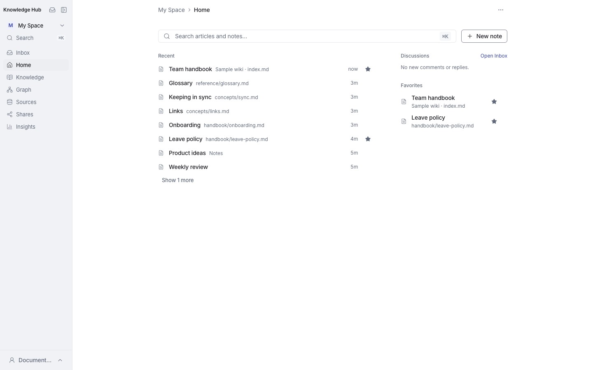
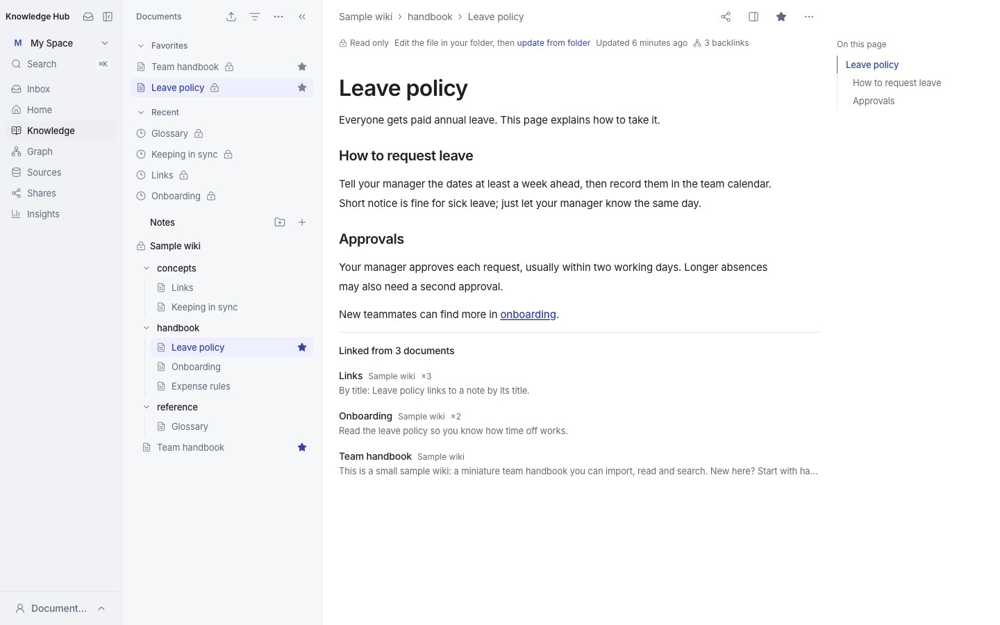
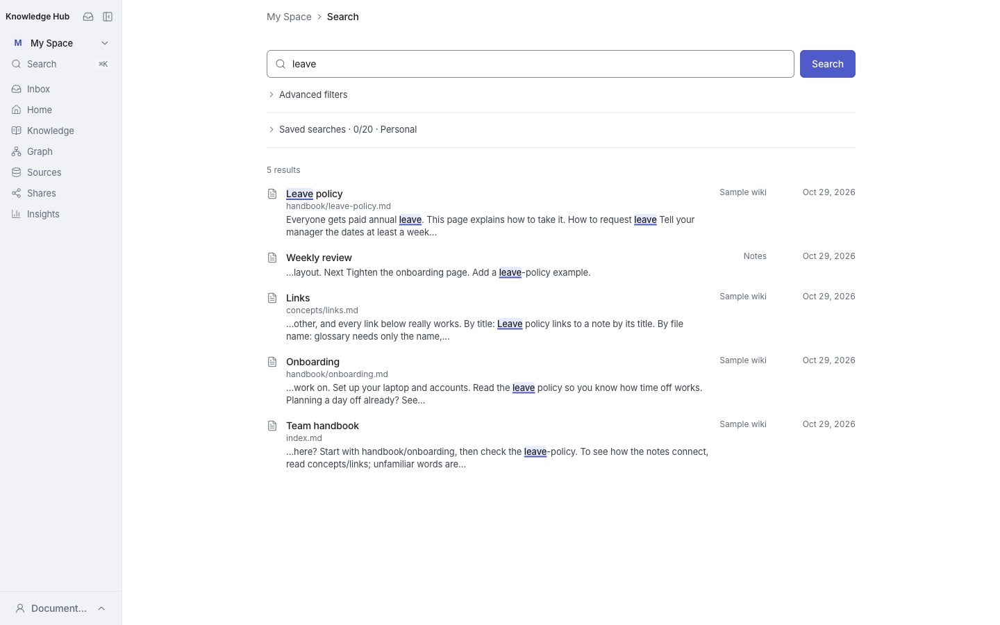
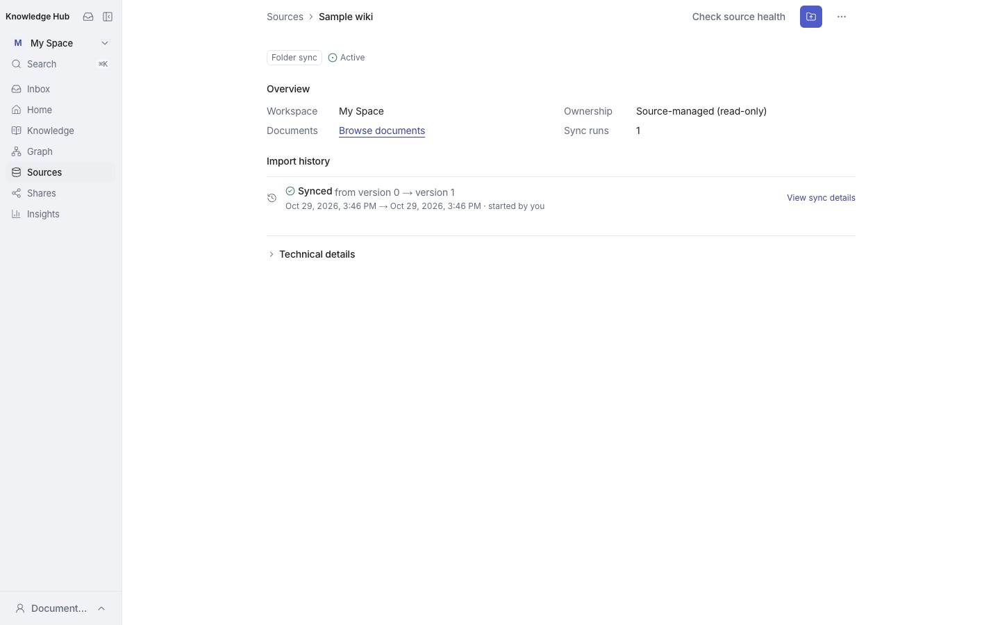
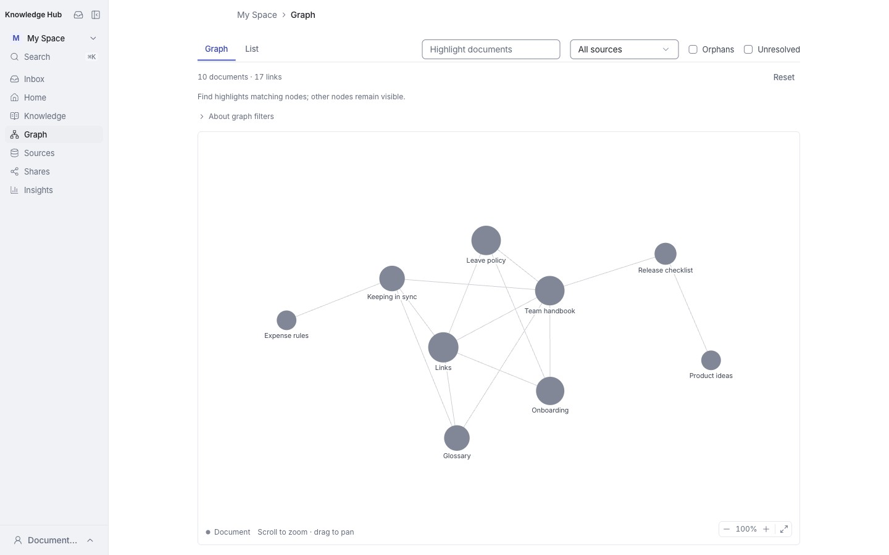

# Knowledge Hub

[English](README.md) | **繁體中文**

[](LICENSE)
[](package.json)

**將 Markdown 筆記變成可閱讀、可連結、可分享的知識空間。**

Knowledge Hub 是開源、可自行部署的知識工作空間。你可以直接在瀏覽器撰寫筆記，也可以匯入既有的 Markdown folder／LLM Wiki，透過搜尋、雙向連結與圖譜探索內容，在分享文件上討論，並匯出需要的內容。內容保留 Markdown 格式，不需要綁定特定筆記軟體、Wiki generator 或外部知識平台。

目前版本為 **0.1.0，持續開發中**。預設提供個人工作空間 **My Space**；Team workspace 的導覽與存取預設關閉，可由管理者開啟。開發模式使用本機示範身分；正式多使用者部署需要整合可信任的身分提供者，詳見[部署](#部署)。

[快速開始](#快速開始) · [功能](#功能) · [設定](#設定) · [開發與測試](#開發與測試) · [參與貢獻](CONTRIBUTING.zh-TW.md) · [授權](#授權)

## 使用者操作手冊

從側欄底部的帳號選單選擇 **Help & guides**（`/help`，所有人共用同一個網址；最後的資料夾格式參考是 `/help#format-reference`），可切換英文與繁體中文。

手冊涵蓋首次匯入、日常同步、授權與錯誤恢復、閱讀、搜尋、Insights、分享、討論與匯出。匯入預覽與同步錯誤會連到對應章節；**Import folder → Read the guide** 仍涵蓋 Markdown 結構、`knowledge_id` 與匯入限制。

操作流程變更時，請同步維護 `src/components/help/user-guide-content.ts` 的兩種語言。

## 介面預覽

以下截圖於 **2026 年 10 月 29 日（Asia/Taipei）**，從 commit [`ba699b4e`](https://github.com/mike840609/knowledge-hub/commit/ba699b4e37ed5fdc22f3633e468aff6ef5a1704d) 的全新 production build 擷取，使用獨立展示帳號、內附英文 sample wiki 與合成筆記。畫面為 **1440 × 900** 桌面版；視窗窄於 1280px 時文件瀏覽器改為抽屜，窄於 1024px 時導覽移入 Menu 抽屜。建置、資料集與驗證細節見[截圖來源紀錄](docs/images/README.md)。

### 個人首頁

Home 集中草稿、最近文件、討論與收藏，Search 與 New note 就在手邊。



### 文件閱讀

閱讀 Markdown，使用文件瀏覽器、頁內大綱、已解析 wikilinks、反向連結，並清楚標示同步來源的唯讀狀態。



### 搜尋

搜尋整個工作空間，並依來源、路徑與更新日期縮小範圍。



### 來源與同步歷史

查看 Markdown folder 的來源管理方式與同步紀錄，再由 **Update from folder** 重新選取來源資料夾並檢查變更。



### 知識圖譜

探索文件間的連結、查找筆記，並依來源或未解析目標篩選圖譜。



## 功能

| 功能 | 說明 |
| --- | --- |
| 個人工作空間 | My Space、Home、Inbox、個人筆記、草稿、收藏與最近閱讀；最近閱讀保留於裝置 |
| Inbox | 未讀更新與活動；視窗夠寬時，選取的討論會顯示在列表旁，可直接回覆、解決與隱藏 |
| Markdown 編輯 | 渲染式編輯與 Markdown 原始碼模式、slash 插入、表格、toggle、callout、程式碼區塊、文件大綱與鍵盤快捷鍵 |
| 草稿與版本 | 帳號草稿自動保存、失敗時本機恢復副本、不可變版本歷史、版本比較與還原、過期編輯衝突檢查 |
| 匯入與同步 | Markdown folder 經 Preview → Apply 匯入；再次選取來源資料夾檢查後續變更；可排除路徑、查看來源健康與重新命名來源 |
| 文件整理 | 文件／資料夾樹、移動、更名、封存與還原；來源管理的內容在 Hub 內為唯讀 |
| 搜尋與檢索 | Workspace 搜尋，支援來源、路徑與日期篩選；`⌘K`／`Ctrl+K` 快速搜尋與最近文件；可儲存搜尋 |
| 知識連結 | `[[wikilink]]`、相對 `.md` 連結、Backlinks、Workspace／Local graph |
| 討論 | 擁有者在段落旁討論、分享頁留言、回覆、解決與隱藏、未讀通知與追蹤中的討論 |
| 分享 | My Space 匿名唯讀文件連結，可設期限與撤銷；收件者可將分享存到 Shares；擁有者可管理與隱藏留言 |
| 匯出 | 單篇 Markdown 下載、My Space ZIP 匯出，保留目錄與穩定 ID/path manifest |
| Agent context | Copy for Agent 與 Workspace 範圍的讀取／context API，沿用應用存取規則並包含討論 |
| Team workspace（需開啟） | Workspace 管理、membership、角色與能力、外部群組映射及 audit |

### 內容由誰管理？

- **Folder Sync（`SOURCE_MANAGED`）**：原始資料夾是內容來源。請在原始 Markdown 檔案修改，再重新產生 Preview 並 Apply。Hub 不直接編輯同步內容，也不會在背景自動監控你的本機資料夾。
- **Web Create／單篇 Upload（`HUB_MANAGED`）**：匯入或建立後由 Hub 管理，可在瀏覽器編輯，儲存時建立新 revision。

Preview 是固定的 staged snapshot。阻擋性診斷必須先處理；若來源版本已變更，Apply 會回傳衝突，需重新產生 Preview。

### 目前限制與未來方向

- 資產目前只儲存 metadata／reference，尚無附件 binary 儲存服務；本機圖片與附件不保證能在線上開啟。
- ZIP 匯出包含封存文件的最新已存版本，不包含草稿、版本歷史或附件 bytes；上限 64 MiB／9,999 份文件。
- 文件以封存／還原管理生命週期，沒有一般使用者的永久刪除流程。
- 搜尋目前以關鍵字為主。MCP server、semantic／hybrid retrieval 與進階 Agent memory 是未來方向，並非現有功能。
- Team 預設顯示 Coming soon。開啟開關不等於完成正式部署的身分整合。
- 討論寫入由 `KM_REVIEW_WRITES_ENABLED` 另外控制；關閉時仍可讀取既有討論及由擁有者管理留言。
- 隱藏討論不等同實際刪除已儲存的資料。

## 快速開始

### 前置需求

- Node.js **20.19.0 以上、25 以下**；[`.node-version`](.node-version) 指定 24.19.0。
- npm（使用 repository 內的 `package-lock.json`）。
- Docker 與 Docker Compose v2（需支援 `up --wait`），用來執行 MariaDB 10.11。
- `make` 與 Git。沒有 `make` 時可使用下方 npm 步驟。

```bash
git clone https://github.com/mike840609/knowledge-hub.git
cd knowledge-hub
make bootstrap
make dev
```

開啟 **http://127.0.0.1:3000/**，進入 My Space。

`make bootstrap` 會安裝依賴、在 `.env` 不存在時複製 `.env.example`、啟動資料庫、執行 migration 並載入開發 fixtures。既有 `.env` 會保留。範例資料庫憑證只供本機開發。

### 不使用 make

```bash
npm ci
cp .env.example .env  # 首次設定；已有 .env 時請保留並檢查內容
docker compose up -d --wait mariadb
npm run db:migrate
npm run db:seed
npm run dev
```

### 第一次使用

1. 選擇 **New note** 建立筆記，或 **Import folder** 匯入 Markdown 資料夾。匯入頁面附有站內資料夾格式指南，也提供 **Try with a sample wiki**：可匯入一份現成的資料夾（英文或繁體中文，位於 `public/sample-wiki/`），並走一般的 Preview → Apply 流程。
2. 匯入時檢查 Preview 的新增、更新、封存與診斷，再套用變更。
3. 在可編輯的筆記中使用 `[[文件標題]]` 連結其他文件；到 Graph 查看關係。
4. 儲存筆記後可使用文件分享選單建立唯讀連結，或下載 Markdown。
5. 本機來源有變動時，重新選取資料夾並走 Preview → Apply 流程。

## 設定

完整的本機開發與匯入限制設定見 [`.env.example`](.env.example)。修改伺服器環境設定後請重新啟動應用。

| 設定 | 用途／預設 |
| --- | --- |
| `KM_DB_HOST`／`KM_DB_PORT` | MariaDB 位址；本機為 `127.0.0.1:3307` |
| `KM_DB_USER`／`KM_DB_PASSWORD`／`KM_DB_NAME` | 應用資料庫帳號、密碼與資料庫名稱 |
| `KM_DB_URL`／`KM_DB_SSL` | 部署環境的資料庫 URL 與 TLS 模式；優先於個別 `KM_DB_*` 設定 |
| `KM_LOCAL_IDENTITY_ENABLED` | 本機開發身分；範例為 `true` |
| `KM_LOCAL_ID`／`KM_LOCAL_EMP_ID`／`KM_LOCAL_NAME`／`KM_LOCAL_ORG_CODE` | 伺服器設定的本機身分，並非登入表單 |
| `KM_TEAM_WORKSPACES_ENABLED` | 預設 `false`；設為 `true` 開啟 Team 導覽與存取 |
| `KM_IDENTITY_PROVIDER` | 預設 `local`；正式環境使用 `company-sso` 並接入 session reader，或使用 `google` demo login |
| `KM_REVIEW_WRITES_ENABLED` | 預設 `false`；開啟後可建立新討論與回覆 |
| `KM_PUBLIC_ORIGIN` | Hub 位於 Gateway 或反向代理之後時，瀏覽器實際使用的 origin；討論請求需要此設定 |
| `KM_SITE_PASSWORD` | 單人操作 Vercel 部署的選用站台密碼 |
| `KM_IMPORT_*` | 匯入檔案數、大小、batch 與 snapshot quota |
| `KM_TEST_DB_*`／`KM_E2E_DB_PREFIX` | 隔離測試資料庫設定；測試帳號需可建立與刪除指定 prefix 的資料庫 |

匯入預設上限為 20,000 個 manifest entries、單篇 Markdown 3.5 MiB、Markdown 總量 256 MiB。完整上限以 `.env.example` 為準。Snapshot retention：BUILDING 2 小時、READY 30 分鐘、STALE／APPLIED 24 小時。有人開始匯入時，伺服器會在背景清除過期的 staging，每個程序最多每 10 分鐘一次。若要立即清除（例如沒有人在匯入的站台），可執行：

```bash
npx tsx scripts/db/cleanup-import-snapshots.ts
```

此清理只處理匯入 staging，不刪除正式文件歷史。

## 部署

Knowledge Hub 採用 Next.js server 與 MariaDB；`compose.yaml` 目前只提供開發資料庫，不是完整的正式部署方案。

```bash
npm ci
npm run db:migrate
npm run build
npm run start
```

**正式環境需要先完成身分整合。** `npm run start` 使用 production 模式，預設的 Local identity 會被拒絕。`KM_ALLOW_LOCAL_IDENTITY_IN_PRODUCTION` 是測試用途，請勿將其作為正式部署方式。

若是**單人操作**的部署，可參考 [Vercel + Layerbase runbook](docs/operations/vercel-layerbase.zh-TW.md)：這條路徑刻意保留 local identity，並以選用的站台密碼保護，於 production build 時執行 migration，同時關閉 preview deployment。請勿將此方式用於共用或公司部署。

若要架設**公開 demo**，同一份 runbook 也記錄了 [Google demo login](docs/operations/vercel-layerbase.zh-TW.md#google-demo-login)：設定 `KM_IDENTITY_PROVIDER=google` 與 `AUTH_*` 變數即可。這是額外的 provider，local 與 company-SSO 路徑完全不受影響。

目前提供通用的 `company-sso` adapter contract，部署者必須實作可信任的 [`CompanySsoSessionReader`](src/modules/identity/ports/company-sso-session-reader.ts)，並在建立 application services 前接入 [`configureCompanySsoSessionReader`](src/server/composition.ts)。reader 必須在回傳的 subject、員工編號、姓名、組織代碼與群組 ID 之外，一併回傳公司帳號名稱 `account` 與選填的英文顯示名稱 `name_en`。單純設定 `KM_IDENTITY_PROVIDER=company-sso` 不會自動提供 OAuth／OIDC 登入頁面或身分服務。分享頁的「Open in Knowledge Hub」與「Get started」連結在設定 `KM_PUBLIC_ORIGIN` 後，會以完整瀏覽器導覽前往該 origin，讓公司 Gateway 對匿名使用者發起 SSO。入口網址會帶 `returnTo=/s/:token/open`；Gateway 必須在 SSO 流程中保留這個 query string。驗證完成後，Hub 只接受開啟分享的路徑，並重跑既有的連結有效性與文件存取檢查。無效或缺少 continuation 參數時，會回到一般 home 目的地；未設定 `KM_PUBLIC_ORIGIN` 時，這些連結維持本機 `/s/:token/open` 流程。

部署時需配置獨立資料庫憑證、資料備份、HTTPS 與可信任的 session 整合。`start` script 綁定 `127.0.0.1`，可搭配同機 reverse proxy；容器部署需自行調整啟動介面的 bind address。勿將範例開發資料庫憑證或測試設定公開使用。

匯入頁的「Try with a sample wiki」會從 `/sample-wiki/*` 取得靜態檔案（`manifest.json` 與各個 Markdown 檔），反向代理或 SSO 允許清單必須讓已登入的使用者存取這個路徑。這些網址是絕對路徑，因此不支援以 Next.js `basePath` 部署。

既有資料庫升級請先閱讀 [Workspace governance cutover](docs/operations/phase3-workspace-governance-cutover.md)，部分 migration 有資料 readiness gate。文件連結索引可依 [rollout 文件](docs/operations/document-link-index-rollout.md) 使用 `npm run db:reindex-document-links` 回填或修復。Team 開關操作見 [Team workspace availability](docs/operations/team-workspaces-availability.md)。

### 文件評論部署

文件評論與 Markdown 分開儲存，不影響 Folder Sync。`KM_REVIEW_WRITES_ENABLED` 預設關閉；關閉時仍可讀取既有討論及由擁有者管理留言。部署在 Gateway 或反向代理之後時，必須將 `KM_PUBLIC_ORIGIN` 設為瀏覽器實際使用的 origin（例如 `https://km.example.com`），否則所有討論請求都會被視為跨來源而拒絕。公司 SSO／Gateway 與登入回跳尚待公司環境整合，不應只因本機測試通過就啟用正式環境寫入。隱藏留言不等同刪除資料。

[Inline review design](docs/superpowers/specs/2026-10-09-shared-personal-document-inline-review-design.md) · [Implementation plan](docs/superpowers/plans/2026-10-09-shared-personal-document-inline-review.md) · [Verification](docs/superpowers/verification/2026-10-09-shared-personal-document-inline-review.md)

## 技術與架構

| 層次 | 技術 |
| --- | --- |
| Web application | Next.js 15、React 19、TypeScript |
| UI | Tailwind CSS、Base UI、Lucide icons |
| Markdown | Milkdown、react-markdown、remark-gfm |
| 知識圖譜 | d3-force |
| 資料庫 | MariaDB 10.11 |
| 測試 | Vitest、Playwright |

應用採 modular monolith，核心模組為 `identity`、`workspaces`、`sources`、`knowledge` 與 `personal`。Web 與 API 共用 application services。

```text
User → WorkspaceMembership → Workspace
                                └── KnowledgeSource
                                      ├── Folder / Document tree
                                      ├── Asset metadata / references
                                      └── KnowledgeDocument (stable ID)
                                            └── KnowledgeRevision (immutable)
```

Workspace 是知識容器與基本存取邊界。使用者的組織屬性不直接授予存取權；知道文件 ID 也不代表有權讀取。公開分享連結是明確建立、可撤銷的單篇唯讀入口。

```text
src/app/             Next.js pages 與 HTTP routes
src/components/      UI、shell、composer、reader、review 與 graph
src/modules/         Domain、application services 與 ports
src/infrastructure/  MariaDB repositories 與 identity adapters
src/server/          請求組合與 server-side read models
src/lib/             共用 client／server helpers
src/shared/          跨模組 domain primitives
scripts/             Migration、seed、維護與測試 runners
tests/               Unit、integration、E2E 與 fixtures
docs/                設計、操作與驗證文件
```

## 開發與測試

| 指令 | 用途 |
| --- | --- |
| `make dev` | 啟動本機開發伺服器 |
| `make dev-reviewer` | 以另一個本機使用者在 port 3001 啟動第二台伺服器，用來試[兩個人的流程](docs/development/two-person-demo.zh-TW.md) |
| `make build`／`make start` | 建置／執行 production build（需身分整合） |
| `make db-up`／`make db-down`／`make db-logs` | 啟動、停止與查看資料庫 logs；`db-down` 保留 volume |
| `make db-migrate`／`make db-seed` | 更新 schema／載入開發 fixtures |
| `make db-reindex-links` | 回填或修復衍生文件連結索引 |
| `make test-unit` | 不需資料庫的單元測試 |
| `make test-integration` | 資料庫整合測試；runner 建立與清除隔離資料庫 |
| `make browsers` | 首次安裝 E2E 使用的 Chromium |
| `make test-e2e` | 建立隔離資料庫、production build 並執行瀏覽器測試 |
| `make guide-screenshots` | 從 sample wiki 重新產生站內手冊截圖 |
| `make test-mermaid-assumptions` | 在 Chromium 檢查 reader 對 Mermaid 的假設；變更版本前後都要跑 |
| `make verify` | Unit tests、TypeScript、lint 與 build |
| `make help` | 完整 make 指令列表 |

```bash
make verify
make test-integration
make browsers
npm run test:e2e:smoke
npm run test:e2e:smoke:personal
```

完整 E2E 預設開啟 Team；另以個人模式檢查預設 rollout：

```bash
npm run test:e2e
KM_E2E_PERSONAL_ONLY=true npm run test:e2e -- personal-workspace.spec.ts
```

測試 runner 自行管理測試模式與所需伺服器，不沿用 `.env` 的 Team 預設值。報告輸出至 `playwright-report/e2e-runs/<suite>/<UUID>/` 與 `test-results/`，不提交至 Git。會產生比較截圖的 spec 也會寫到 `test-results/ui-comparisons/`；`docs/ui-comparisons/` 下已追蹤的 before／after 證據只在 `KM_UPDATE_UI_COMPARISONS=1` 時重寫。覆蓋範圍見 [E2E coverage matrix](docs/superpowers/verification/2026-10-02-e2e-coverage-matrix.md)。

### Next.js patch

`npm ci` 的 postinstall 會使用 `patch-package` 套用 [`patches/next+15.5.25.patch`](patches/next+15.5.25.patch)，修正內附 React（`19.2.0-canary-0bdb9206-20250818`）的兩個問題：一是頁面導覽時遺失 render ping；二是另一個導覽仍在載入時，若有 redirect 或其他錯誤在 render 中送達（例如「Browse documents」還在轉址時就點了另一份文件），React 的錯誤復原會把 Next 的 `Router` 只 render 一半就 commit，下一次 render 拋出 React #310（Rendered more hooks than during the previous render），整頁變成「Application error」。此修正即 [facebook/react#36911](https://github.com/facebook/react/pull/36911) 的那一個條件，套用於四個 `react-dom` client 與 profiling build。請勿跳過 install scripts；若已使用 `--ignore-scripts`，補跑 `npx patch-package`。

第二個修正已對照 #36911 的上游 diff；[vercel/next.js#95368](https://github.com/vercel/next.js/pull/95368) 將它帶進 Next canary（React `ec0fca31-20260701`）。這兩個 PR 引用的 issue（vercel/next.js#63121、#78396，facebook/react#33580）只讀過摘要，未在此重現。`next/dist/compiled/react-dom-experimental` 的 experimental React 未修補：只有在 `next.config.ts` 啟用 experimental React 功能時才會載入，本專案沒有啟用。

升級 Next.js 時請確認此 patch 是否仍需要：[`vendored-react-ping-fix.test.ts`](tests/unit/vendored-react-ping-fix.test.ts) 檢查內附原始碼中的兩個修正，在 Next 內附的 React 已含這些修正時，不靠 patch 也會通過；[`router-redirect-during-navigation.spec.ts`](tests/e2e/router-redirect-during-navigation.spec.ts) 在瀏覽器中重現這個崩潰，證據見[驗證紀錄](docs/superpowers/verification/2026-10-06-react-310-redirect-recovery-verification.md)。更新或移除後清掉 `.next/cache` 再 build。

### Mermaid 版本

`mermaid` 固定在 `~12.2.0`。Reader 只繪製清單中的 diagram 類型，並限制 diagram 自身文字可設定的 config keys，另有一套 sanitiser 設定（[`mermaid-queue.ts`](src/components/knowledge/mermaid-queue.ts)）；這三項都是因為該版本在瀏覽器中的實際行為才存在。變更版本前與變更後都要執行：

```bash
make test-mermaid-assumptions
```

[`scripts/test/mermaid-assumptions.mjs`](scripts/test/mermaid-assumptions.mjs) 會在 Chromium 中以敵意文字排版清單中的每種 diagram，並套用 production policy 的 fetch directives；假設不再成立時會以非零狀態結束。它不屬於 `make verify` 或 CI。[規格](docs/superpowers/specs/2026-10-13-reader-mermaid-design.md)說明每個假設保護什麼。

## 疑難排解

- **資料庫連線失敗**：確認 Docker 運行、`make db-logs` 與 `.env` 憑證。本機 DB 使用 3307，開發 Web 使用 3000，E2E 預設使用 3101。
- **Team 入口無法使用**：預設 Coming soon；設定 `KM_TEAM_WORKSPACES_ENABLED=true` 並重啟。
- **production 身分錯誤**：Local identity 不提供正式部署登入；需接入 SSO session reader，或使用文件中的 Google demo provider。
- **匯入無法 Apply**：先處理 Preview 的 blockers；409 版本衝突需重建 Preview，沒有 Force Apply。
- **連結或圖譜缺少資料**：確認 migrations 已完成，再執行 `make db-reindex-links`；同步文件的 wikilink 問題請回來源修改。
- **無法新增留言**：設定 `KM_REVIEW_WRITES_ENABLED=true` 並重啟。若在 Gateway 之後，還要設定 `KM_PUBLIC_ORIGIN`；否則討論請求會被視為跨來源而拒絕。
- **需要重建本機示範資料**：`make db-reset` 會刪除開發資料庫 volume 及其中全部內容，執行前先備份。

## 文件與參與

專案文件以英文為主。每份專案 Markdown 指南都有相鄰的 `*.zh-TW.md` 中文版本，並在標題下方提供雙向語言連結。部分原本以英文撰寫的歷史文件，在中文閱讀導引下保留完整英文技術原文，並明確註明。歷史紀錄保存當時的技術背景；目前行為請以 canonical 文件為準。

- [貢獻指南](CONTRIBUTING.zh-TW.md)：回報問題、提出功能與送出 Pull Request。
- [安全性回報](SECURITY.zh-TW.md)：私下回報漏洞與部署注意事項。
- [操作文件](docs/operations/)：資料庫升級、Team 開關、部署與索引維護。
- [設計規格](docs/superpowers/specs/)與[實作計畫](docs/superpowers/plans/)：詳細行為契約與決策背景。
- [驗證紀錄](docs/superpowers/verification/)：各功能的測試與檢查證據。
- [GitHub Issues](https://github.com/mike840609/knowledge-hub/issues)：一般問題與功能建議。

歷史設計與 roadmap 保存開發背景，可能包含尚未實作或已調整的構想。可用功能以目前原始碼與測試為準；README 的功能表提供使用者入口。

### 目前的 canonical 文件

這些文件定義核心契約與實作計畫；後續專項規格記錄新增功能，附日期的驗證紀錄描述當時的執行證據。

| 領域 | 設計 | 計畫 | 範圍 |
| --- | --- | --- | --- |
| 基礎與架構 | [規格](docs/superpowers/specs/2026-09-10-phase-0-foundation-architecture-design.md) | [計畫](docs/superpowers/plans/2026-09-10-phase-0-foundation-implementation.md) | 模組邊界、schema、transactions、工作空間存取。 |
| 知識核心與樹 | [規格](docs/superpowers/specs/2026-09-10-phase-1-knowledge-core-tree-design.md) | [計畫](docs/superpowers/plans/2026-09-10-phase-1-knowledge-core-tree-implementation.md) | 文件身分、版本、樹位置與生命週期。 |
| Folder 匯入與同步 | [規格](docs/superpowers/specs/2026-09-12-phase-2-knowledge-source-import-sync-design.md) | [計畫](docs/superpowers/plans/2026-09-12-phase-2-knowledge-source-import-sync.md) | 暫存、預覽、原子套用與來源所有權。 |
| 身分與工作空間治理 | [規格](docs/superpowers/specs/2026-09-14-phase-3-identity-workspace-governance-design.md) | [計畫](docs/superpowers/plans/2026-09-14-phase-3-identity-workspace-governance.md) | 角色、能力、成員資格、SSO 與切換。 |
| 探索與讀取 API | [規格](docs/superpowers/specs/2026-09-16-phase-4-discovery-read-api-design.md) | [計畫](docs/superpowers/plans/2026-09-16-phase-4-discovery-read-api.md) | 授權搜尋與有界文件讀取。 |
| 人工撰寫 | [規格](docs/superpowers/specs/2026-09-16-phase-5-human-authoring-design.md) | [計畫](docs/superpowers/plans/2026-09-16-phase-5-human-authoring.md) | 上傳、建立、編輯與版本衝突。 |
| 文件分享 | [規格](docs/superpowers/specs/2026-09-23-document-share-link-design.md) | [計畫](docs/superpowers/plans/2026-09-23-document-share-link.md) | 可到期、可撤銷的單篇文件讀取。 |
| 文件評論 | [規格](docs/superpowers/specs/2026-10-09-shared-personal-document-inline-review-design.md) | [計畫](docs/superpowers/plans/2026-10-09-shared-personal-document-inline-review.md) | 有效連結可免登入閱讀評論、登入後留言、擁有者管理與同步錨點；公司環境另行驗證後啟用。 |
| 擁有者的留言側欄 | [規格](docs/superpowers/specs/2026-10-12-owner-comments-rail-design.md) | — | 擁有者的留言顯示在對應段落右側、取代大綱的位置；文件區太窄時改用抽屜。 |
| 留言錨點與擁有者討論 | [規格](docs/superpowers/specs/2026-10-13-review-anchors-and-owner-threads-design.md) | — | 可在表格儲存格與程式碼留言；無法留言的選取會說明原因；擁有者可發起討論；callout、task list 或 footnote 不再停用留言。 |
| 已儲存的分享 | [規格](docs/superpowers/specs/2026-10-12-saved-shares-design.md) | [計畫](docs/superpowers/plans/2026-10-12-saved-shares.md) | 保存別人分享的文章連結，可跨裝置使用；與最愛分開，閱讀權限仍由原分享連結控制。 |
| 追蹤中的討論 | [規格](docs/superpowers/specs/2026-10-23-followed-discussions-tab-design.md) | [計畫](docs/superpowers/plans/2026-10-23-followed-discussions-tab.md) | Shares → Discussions 列出讀者追蹤的討論；沒有有效連結時仍可取消自己的追蹤。 |
| 閱讀頁 callout | [規格](docs/superpowers/specs/2026-10-12-reader-callouts-design.md) | — | `> [!NOTE]` 與 GitHub 另外四種類型在閱讀頁和分享頁顯示成 callout；儲存的 Markdown 不變。 |
| 閱讀頁 HTML 子集 | [規格](docs/superpowers/specs/2026-10-12-reader-html-subset-design.md) | — | 閱讀頁和分享頁認得七個不帶屬性的 HTML 標籤；其餘照原樣顯示成文字，使用者寫的 HTML 一律不直接輸出。 |
| Content-Security-Policy | [規格](docs/superpowers/specs/2026-10-12-content-security-policy-design.md) | — | 每個頁面的 script 都要帶該次回應的 nonce 才能執行；不允許 inline script 與事件處理器。 |
| 閱讀頁 Mermaid | [規格](docs/superpowers/specs/2026-10-13-reader-mermaid-design.md) | [計畫](docs/superpowers/plans/2026-10-13-reader-mermaid.md) | `mermaid` 區塊在閱讀頁和分享頁畫成圖片，永不當成 markup；無法繪製時保留為程式碼並說明原因。 |
| 編輯器的閱讀樣式提示 | [規格](docs/superpowers/specs/2026-10-12-editor-reader-hints-design.md) | — | 編輯器以 decoration 提示 callout 與行內 HTML 子集的樣子；標記保留，儲存的 Markdown 不變。 |
| 文件樹按需載入 | [規格](docs/superpowers/specs/2026-10-24-lazy-source-trees-design.md) | [計畫](docs/superpowers/plans/2026-10-24-lazy-source-trees.md) | 初始載入目前來源，其餘展開時讀取；支援重試，並與移動對話框共用資料。 |
| 文件編輯器 | [規格](docs/superpowers/specs/2026-09-28-document-composer-design.md) | [計畫](docs/superpowers/plans/2026-09-28-document-composer.md) | 渲染編輯與 Markdown 原始碼模式。 |
| 行內編輯 | [規格](docs/superpowers/specs/2026-10-16-inline-editing.md) | — | 在閱讀頁直接編輯，搭配 autosave 與段落討論；checkpoint 歷史是後續政策。 |
| 知識連結與圖譜 | [規格](docs/superpowers/specs/2026-09-29-personal-workspace-knowledge-graph-design.md) | [計畫](docs/superpowers/plans/2026-09-29-personal-workspace-knowledge-graph.md) | Wikilinks、反向連結、標題錨點與衍生圖譜資料。 |
| 個人日用功能 | [規格](docs/superpowers/specs/2026-09-29-personal-daily-driver-design.md) | [計畫](docs/superpowers/plans/2026-09-29-personal-daily-driver.md) | Wikilink 保留、自動完成、程式碼區塊與整理。 |
| 個人工作空間推出 | [規格](docs/superpowers/specs/2026-09-30-personal-workspace-design.md) | [計畫](docs/superpowers/plans/2026-09-30-personal-workspace.md) | 帳號草稿、收藏、版本還原與匯出。 |
| Home 續接 | [規格](docs/superpowers/specs/2026-10-19-home-continue-design.md) | [計畫](docs/superpowers/plans/2026-10-19-home-continue.md) | Home 上的草稿、最近文件與收藏。 |
| 探索與 Copy for Agent | [規格](docs/superpowers/specs/2026-10-04-mvp-discovery-agent-design.md) | [計畫](docs/superpowers/plans/2026-10-04-mvp-discovery-agent.md) | Folder 範圍、搜尋篩選與經檢視的 Markdown bundles。 |
| 範例知識庫與匯入指南 | [規格](docs/superpowers/specs/2026-10-06-sample-wiki-import-guide-design.md) | [計畫](docs/superpowers/plans/2026-10-06-sample-wiki-import-guide.md) | 內附雙語範例知識庫，以及顯示即時限制的站內匯入指南。 |
| 檢索優先版型 | [規格](docs/superpowers/specs/2026-10-28-retrieval-first-shell-design.md) | — | 1024–1279px 時文件瀏覽器改為抽屜；Favorites 與 Recent 預設展開；搜尋仍是主要入口。 |
| Google demo login | [規格](docs/superpowers/specs/2026-10-25-google-login-design.md) | [計畫](docs/superpowers/plans/2026-10-25-google-login.md) | 公開 demo 的額外 Google provider。 |
| Vercel + Layerbase 部署 | [規格](docs/superpowers/specs/2026-10-24-vercel-layerbase-deployment-design.md) | [計畫](docs/superpowers/plans/2026-10-24-vercel-layerbase-deployment.md) | 單人操作部署，使用站台密碼與 build-time migrations。 |
| 來源重新命名 | [規格](docs/superpowers/specs/2026-10-26-source-rename-design.md) | [計畫](docs/superpowers/plans/2026-10-26-source-rename.md) | 只改來源顯示名稱，不改變資料夾身分。 |
| Inbox 分割檢視 | [規格](docs/superpowers/specs/2026-10-29-inbox-split-view-design.md) | — | 視窗達 75rem 時，列表與選取的討論並排；較窄時維持列表。 |
| 使用者 account | [規格](docs/superpowers/specs/2026-10-29-users-account-design.md) | [計畫](docs/superpowers/plans/2026-10-29-users-account.md) | 儲存 Company SSO 的 account 與選填英文名稱，供未來的 mention autocomplete 使用。 |

另見[階段路線圖](docs/superpowers/roadmaps/2026-09-10-knowledge-hub-phase-roadmap.md)、[動作模型](docs/superpowers/specs/2026-09-21-action-model-spec.md)、[快捷鍵](docs/superpowers/specs/2026-09-24-keyboard-shortcuts-design.md)、[列鍵盤操作](docs/superpowers/specs/2026-10-02-row-keyboard-actions-design.md)，以及持續原地更新、不附日期的[前端設計語言](docs/superpowers/specs/frontend-design-language.md)。

## 授權

Knowledge Hub 以 **[MIT License](LICENSE)** 授權，可使用、修改與散布。再散布時請保留原始版權與授權聲明。第三方依賴保留各自的授權條款。
