# PR 367 — before/after screenshots

Captured at 1440×900 in the PR's production build, with the same seeded personal workspace and content:

- **Before:** `b66a360a` (the PR base, current `main` at the time).
- **After:** `99172543` (the PR head).

Each pair drives the same scenario; only the build differs.

## 1. Document page

Before, the path line truncates the title, the favorite star and Full width sit in the header, Share is icon-only, and a document with no discussions has no Comments entry. After, the path line shows the full title, Share is labeled, Comments is always available for a writable document, and Full width and the favorite live in Document actions. The explorer also shows Favorites and Recent inline.

| Before | After |
| --- | --- |
| 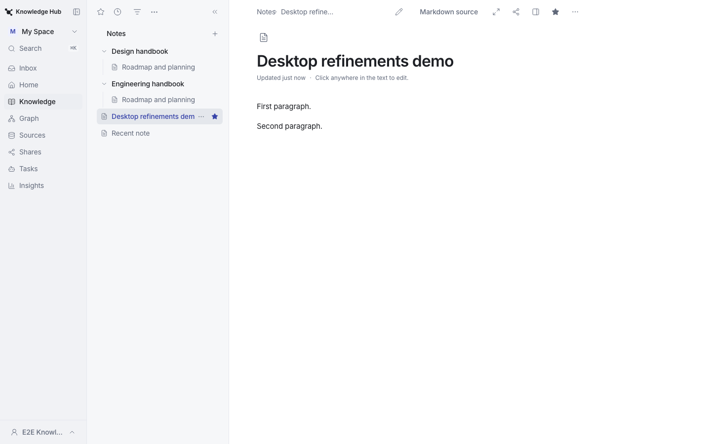 | 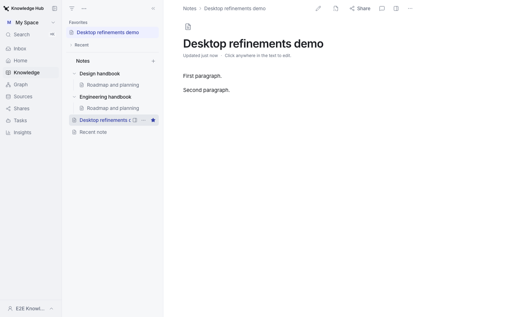 |

## 2. Explorer: Favorites and Recent

Before, Favorites and Recent are star and clock menus in the explorer toolbar. After, Favorites is a short list above the tree and Recent is a disclosure below it, collapsed by default and remembered per workspace.

| Before | After |
| --- | --- |
| 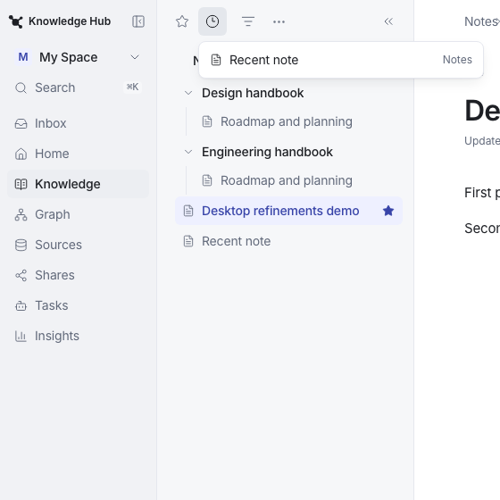 | 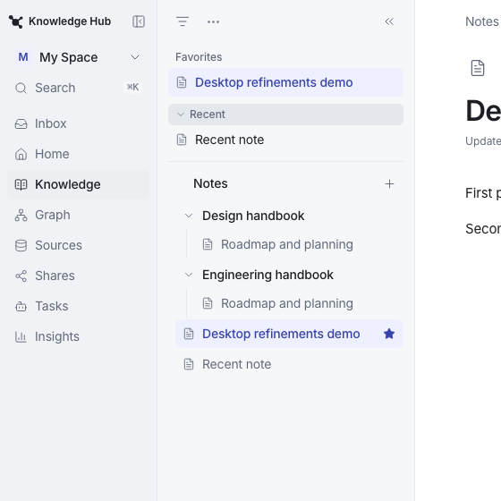 |

## 3. Quick search: document results first, with folder paths

Querying the title of the open document, before lists the eight "This document" actions first (the old matcher included the document's own title in every action's keywords) and the two matching documents carry only "Notes". After puts the two documents first with "Notes › Design handbook" and "Notes › Engineering handbook".

| Before | After |
| --- | --- |
| 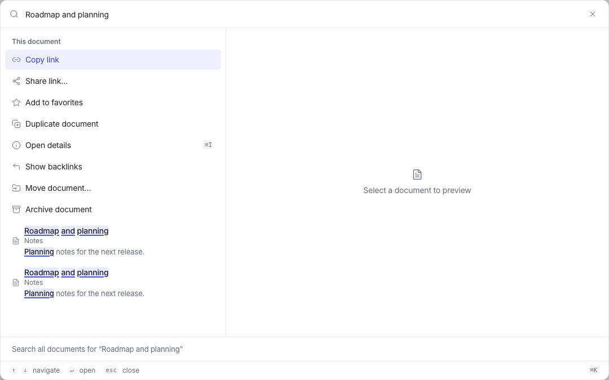 | 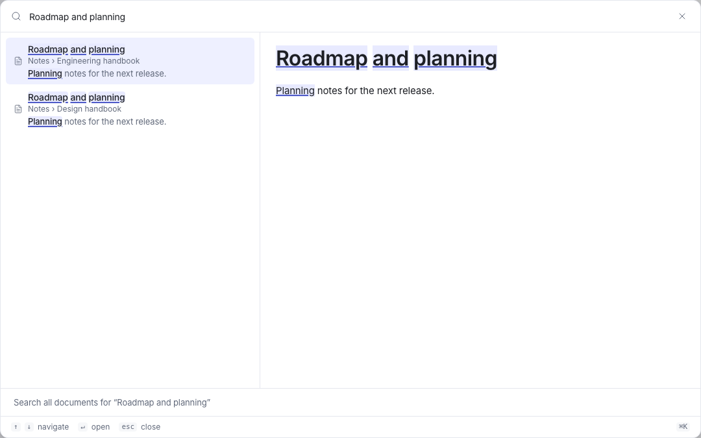 |

## 4. Share link: scope beside Create link

Before, the long safety description fills the top of the dialog. After, a compact audience and scope summary sits beside Create link and follows the selected expiry.

| Before | After |
| --- | --- |
| 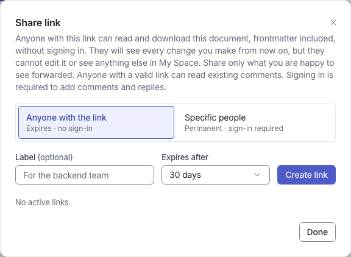 | 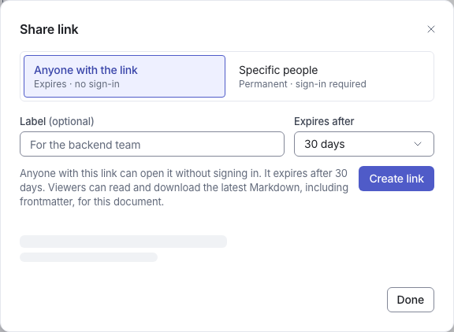 |

## 5. Block menu: Copy link to block and Comment

Before, the block menu is Turn into / Duplicate / Delete / Move up / Move down. After adds Copy link to block and Comment.

| Before | After |
| --- | --- |
| 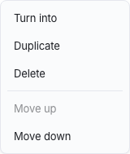 | 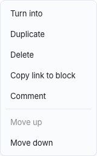 |

## 6. Creating a note: title and body while the request is pending

The create request is held open in both builds. Before, only the title accepts input. After, the title and body both accept input and are carried into the editor when it opens.

| Before | After |
| --- | --- |
| 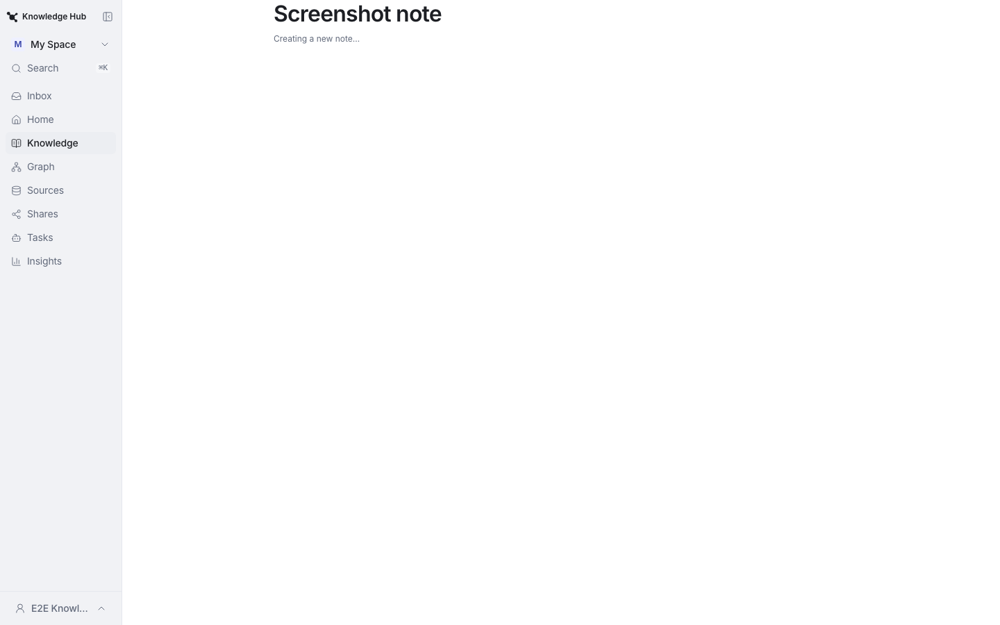 | 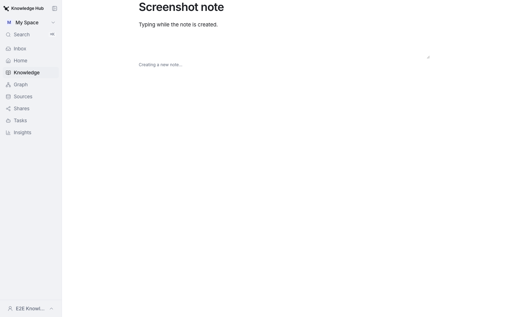 |

## Evidence

The screenshots were produced by a temporary Playwright spec run through `scripts/test/e2e.ts` against a freshly seeded database for each build; no production data was used.
