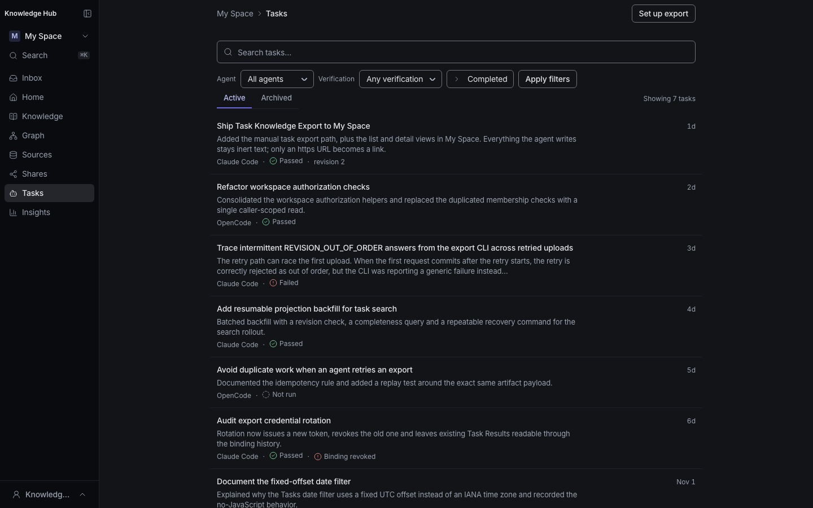
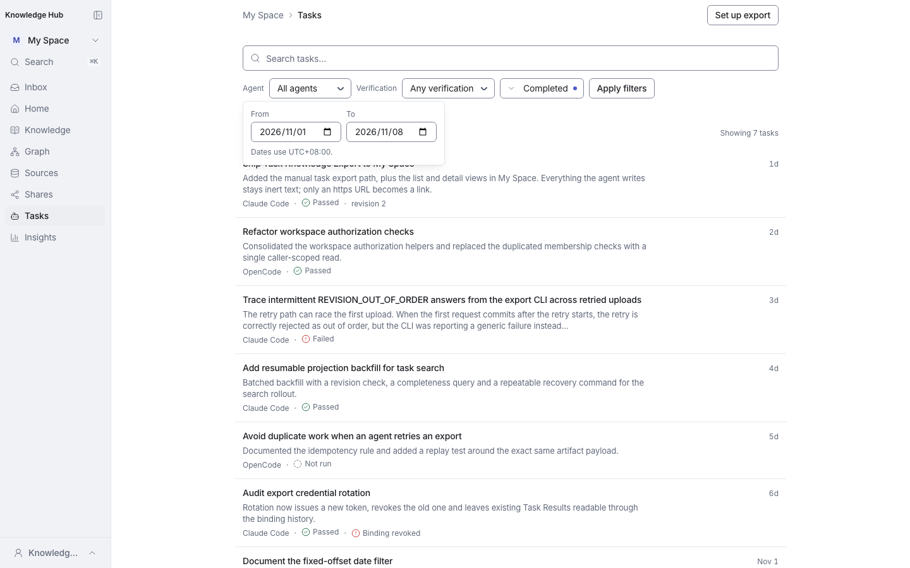
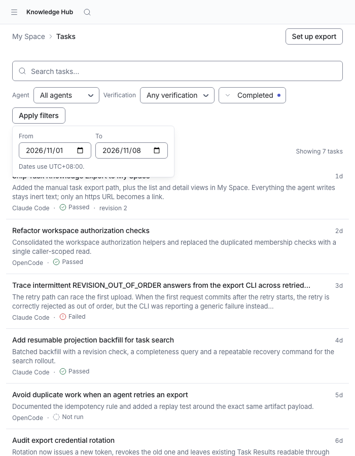
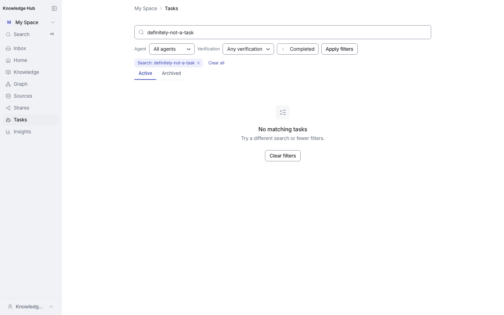
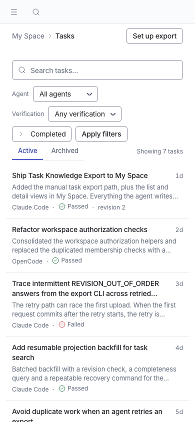
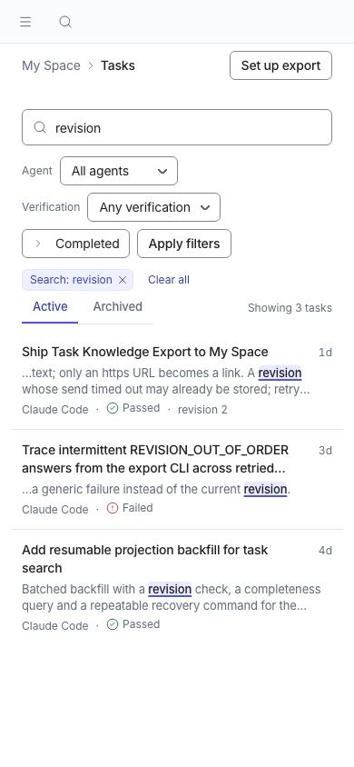
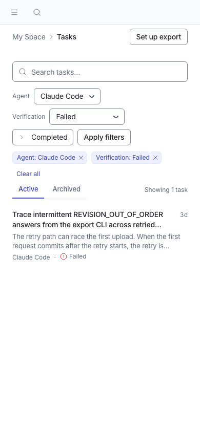
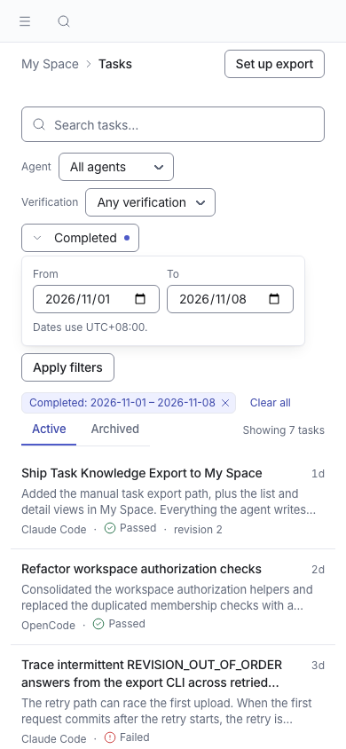
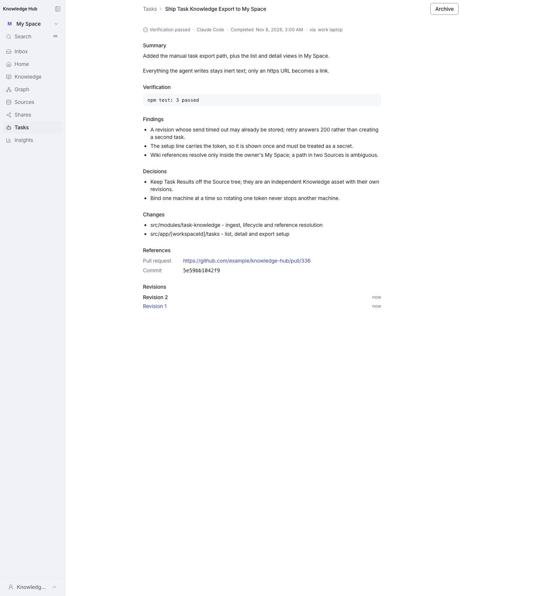

# Task pages refinement screenshots

Captured from `feat/task-pages-refinement` rebased on `main` after #337 (lavender tabs and filters), with `TASK_SEARCH_READ_ENABLED=true`. Desktop 1440 × 900, mobile 390 × 844. Seeded local data only.

The change keeps the search-enabled Tasks page on the same full-width rhythm as the rest of My Space, replaces the reading-column form with a compact toolbar, uses the shared underline tabs, and gives each result row a bounded excerpt with the matched term in view. This gallery focuses on the search-enabled surface; the flag-off Task list/detail/setup changes are in the same PR and share the same shell.

## Search-enabled Tasks

| State | Light | Dark |
|---|---|---|
| Default list |  |  |
| Search results (`q=revision`) |  | |
| Agent + verification filters |  | |
| Completed date filter |  | |
| Completed date filter, tablet (700px) |  | |
| No matches |  | |
| Empty workspace |  | |

### Mobile (390 × 844)

| State | Screenshot |
|---|---|
| Default list |  |
| Search results |  |
| Agent + verification filters |  |
| Completed date filter |  |
| Empty workspace |  |

### Task detail

## Local `.env` verification

- The worktree `.env` carries `TASK_SEARCH_READ_ENABLED=true`; `npm run dev` reports `Environments: .env`.
- Migration 034 was already applied; `task_result_search` was backfilled with `npx tsx scripts/db/backfill-task-search.ts --target dev --run` → `{"indexed":1,...,"complete":true}`.
- The local dev server renders the search-enabled Tasks page at 1440 and 390 without horizontal overflow; `?q=export` returns the local task, `?q=zzz` shows the no-match state.

## Verification

- `npm run typecheck`
- `npm run lint`
- `npm run test:unit` — 382 files, 4,595 tests passed
- `npx tsx scripts/test/e2e.ts tests/e2e/task-search-my-space.spec.ts tests/e2e/task-export-my-space.spec.ts` — 4 tests passed
- Impeccable design detector — `[]`
