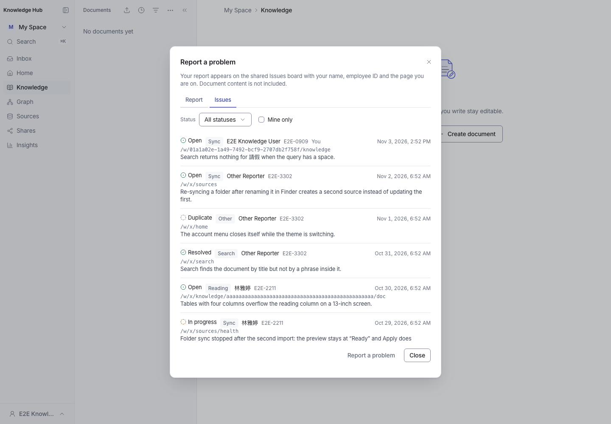
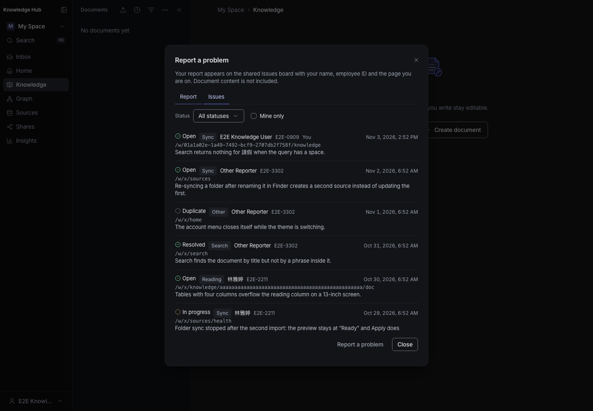
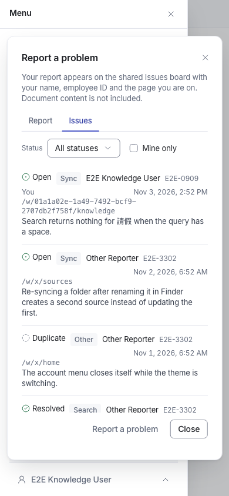

# Reported issues panel — visual check

Captures of the **Report a problem** dialog's Issues tab from the isolated E2E
build of `feat/feedback-issues-board`. The database held fixture reports only —
three reporters, all four statuses, one maximum-length path — and no production
data.

The board is a low-frequency surface and belongs to no Workspace: it is the
second tab of the dialog the account menu already opens. Closing the dialog
leaves the reader on the page they were on; there is no route, no rail row and
no page change.

| Capture | What it shows |
| --- | --- |
| `report-dialog.png` | The Report tab, unchanged except for the visibility sentence |
| `issues-dialog.png` | The Issues tab at 1440×1000: Status / Mine only, six rows, `Report a problem` and Close |
| `issues-dialog-dark.png` | The same tab in the dark palette |
| `issues-dialog-narrow.png` | 390×844 via the drawer: the list scrolls inside the dialog and long text wraps |

Rows carry the status glyph and word, the category, the reporter's name and
`emp_id` (with `You` on the reader's own), the page path, the time and the
description. A description past 280 code points shows a preview and opens the
rest beneath `Show the full report`. `Load more` appends the next 20.

Captured with a throwaway Playwright spec against the E2E harness, which
provisions the isolated database and builds the app; the spec was not
committed.
