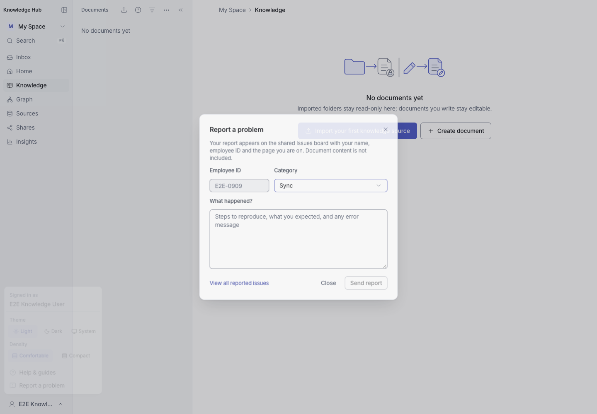
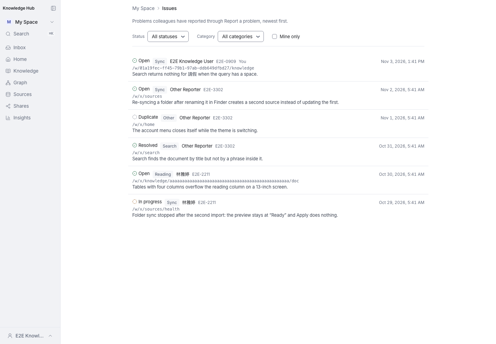
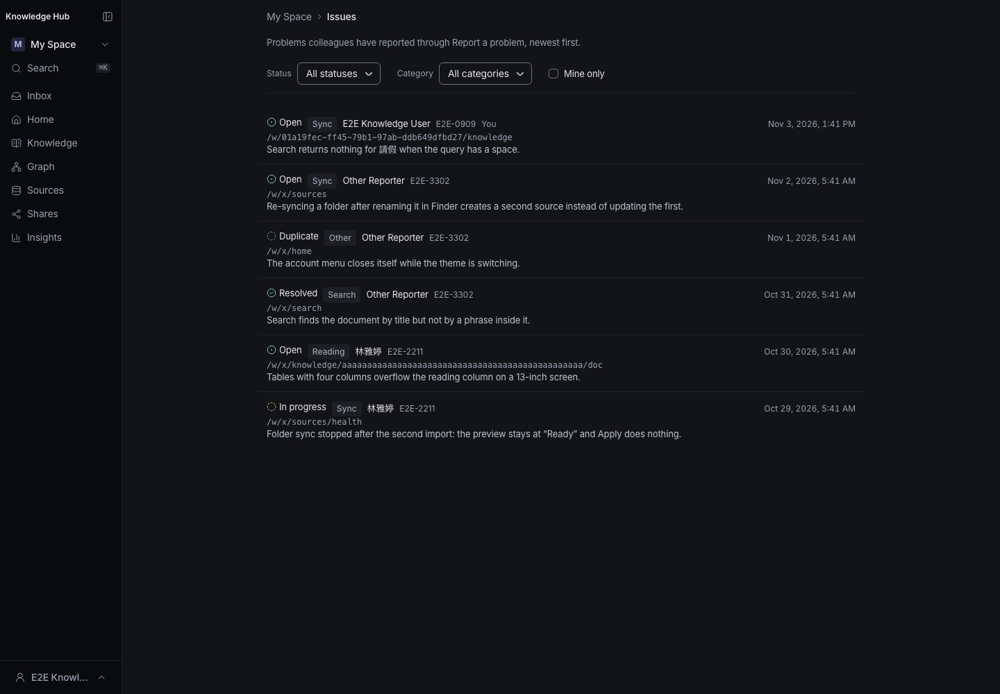
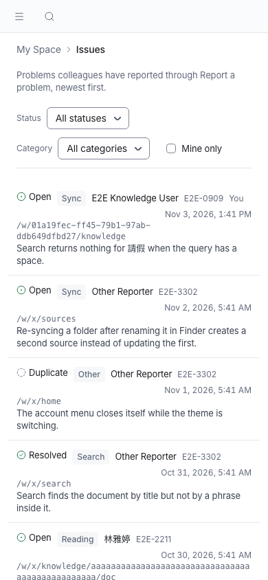

# Reported issues board — visual check

Captures of `/w/[workspaceId]/issues` from the isolated E2E build of
`feat/feedback-issues-board`. The database held fixture reports only — three
reporters, all four statuses, one maximum-length path — and no production data.

The board is deliberately not a rail row: it is a low-frequency surface,
reached from the **Report a problem** dialog's `View all reported issues` link.
`report-dialog.png` shows that entry point. The route itself stays
personal-workspace only, so the link always opens My Space even when the
dialog was opened from a Team workspace.

| Capture | What it shows |
| --- | --- |
| `report-dialog.png` | The report dialog with the board link, on the left of Close / Send report |
| `issues-light.png` | Desktop 1440×1000, light theme: header, filters, six rows, and a rail with no Issues row |
| `issues-dark.png` | The same page in the dark palette |
| `issues-narrow.png` | 390×844: filters stack, the timestamp wraps under the reporter, and a long unbroken path wraps instead of overflowing (`document.scrollWidth === 390`) |

The 280-character preview ends in `…`; "Show the full report" opens the
remainder. A report the reader sent carries the muted `You` marker.

Captured with a throwaway Playwright spec against the E2E harness, which
provisions the isolated database and builds the app; the spec was not
committed.
