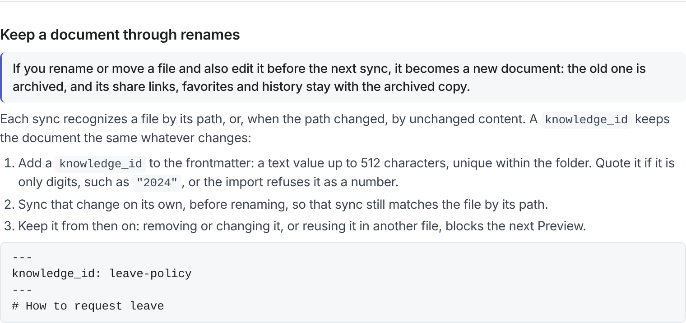
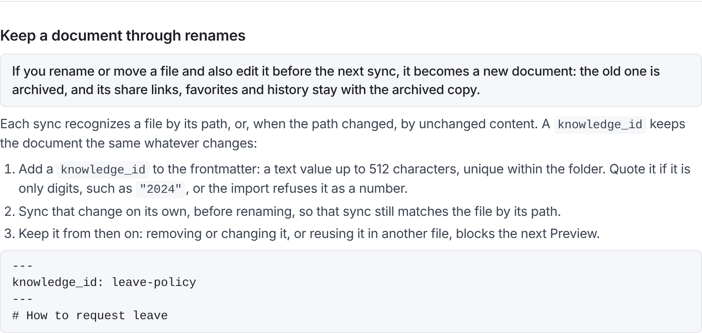
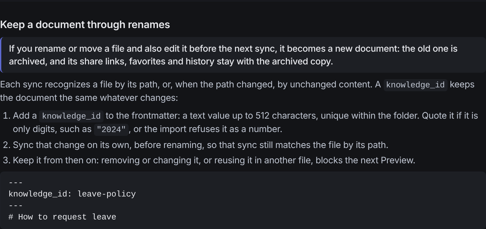
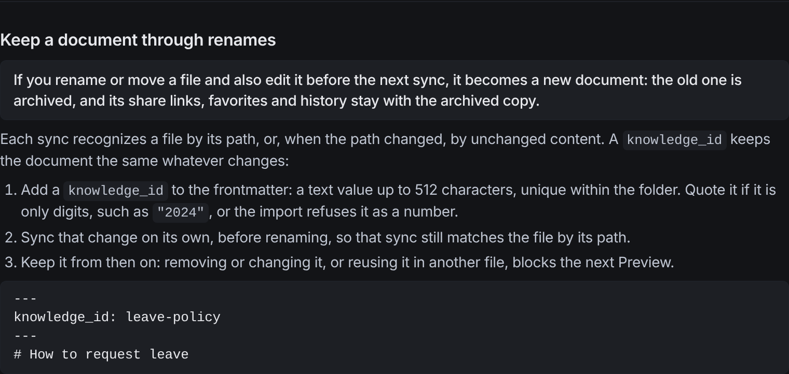
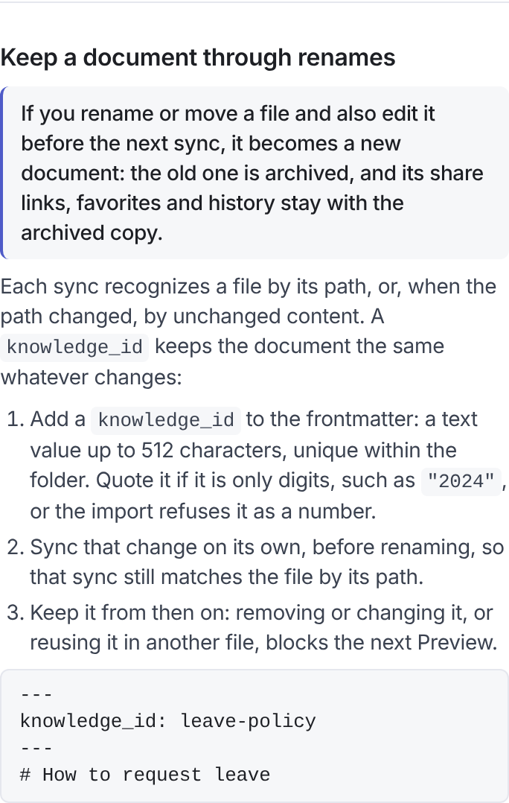
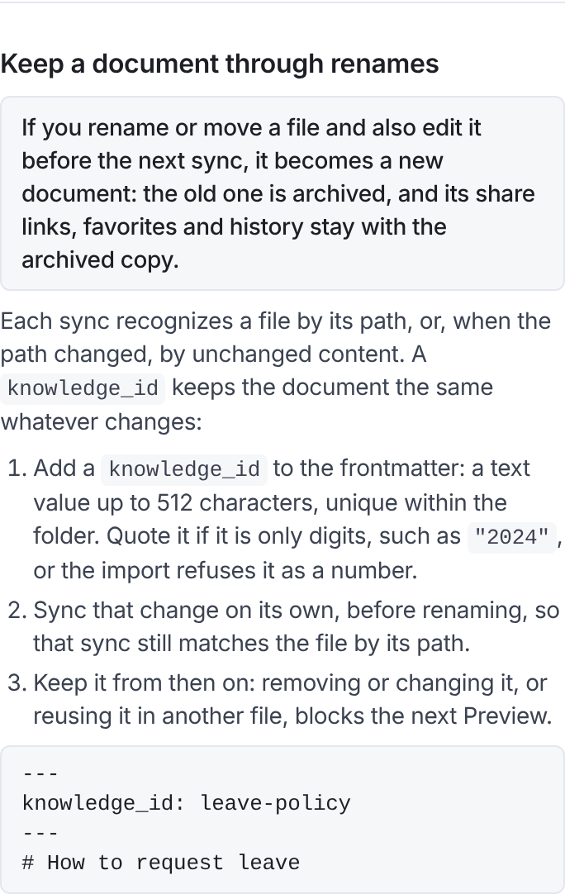

# Audit polish verification

Named stacking layers, balanced headings and the import-guide note
(`docs/superpowers/specs/frontend-design-language.md` §3, §6, §9). Before is
`main` at `174a68f`; after is this change. Both were captured with Playwright
against the e2e server at device scale 2.

## Balanced headings

A shared document at 390px. The title and the `h2` wrap into even lines
instead of leaving a short last line.

| Before | After |
|---|---|
|  |  |

## Import guide note

The user guide's `knowledge_id` note. The coloured left stripe is replaced by
the app's bordered notice.

| | Before | After |
|---|---|---|
| Light |  |  |
| Dark |  |  |
| 390px |  |  |

## Stacking layers

There is no screenshot: every layer keeps its number, so nothing changes on
screen. The compiled CSS gives `z-palette` 60, `z-toast` 70, `z-tooltip` 80,
`z-lightbox-backdrop` 90 and `!z-lightbox` 100 `!important`, the values of the
classes they replace.

## Checks

- Full unit suite: 418 files, 5,631 tests passed. Typecheck and lint passed.
- `tests/e2e/retrieval-layout.spec.ts`, after its Recent test was made to wait
  for the stored visit: 30 of 30 runs passed locally (`--repeat-each=5`).
  Before that wait it failed 4 of 6 on `main` as well.
