# Review: Google Docs parity, verification (2026-11-26)

Five changes to the comment (review) panels, specified in the 2026-11-26 amendments of
[the inline review spec](../specs/2026-10-09-shared-personal-document-inline-review-design.md)
(with in-place amendments to the owner rail, named-recipient share, review mention highlight and
frontend design language specs):

1. **Open first.** Both panels start on Open; with nothing open the list says "Every comment is
   resolved." and offers Show resolved; the shared Comments entry counts open discussions.
2. **Resolved passages fade.** A resolved discussion's passage gets no highlight or margin marker
   under Open, unless it is the active discussion.
3. **⌘⌥M / Ctrl+Alt+M** comments on the selected text (shared page, NAMED Hub reader, owner page
   and editor); nothing for an anonymous reader.
4. **Copy link to discussion** on every open card, for every reader.
5. **Mine / Mentions me** filters for signed-in readers (owner: Mine only).

Screenshots: Chromium, `deviceScaleFactor` 2, taken by a temporary spec run through
`scripts/test/e2e.ts` — before on a worktree of `origin/main` (e0f5cf4), after on this branch. The
document has three discussions; the middle one ("internal users") is resolved.

## Shared page, desktop 1280

| Before | After |
| --- | --- |
| 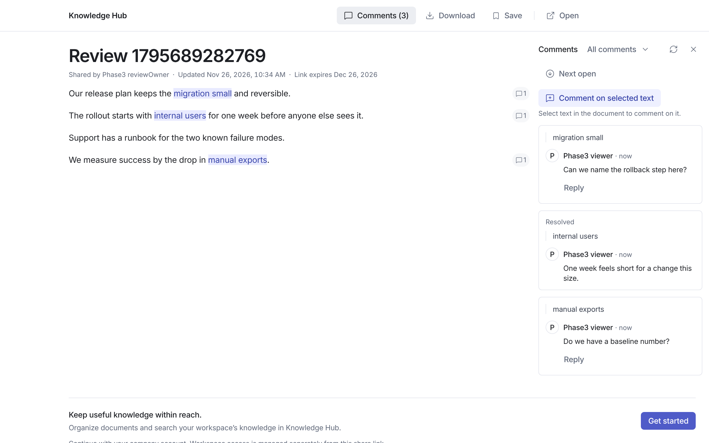 | 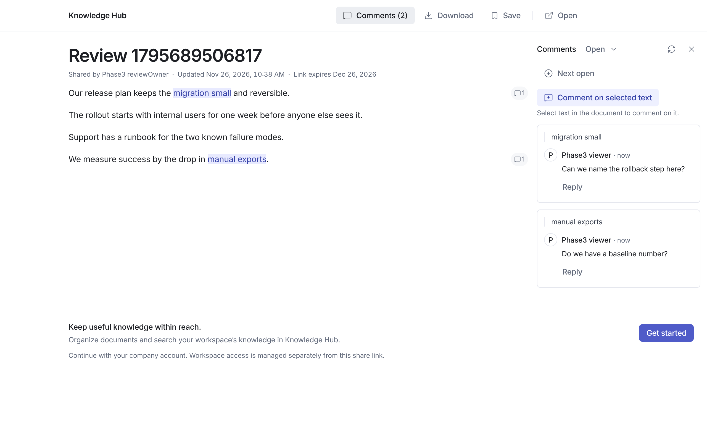 |

## Every discussion resolved, desktop 1280

| Before | After |
| --- | --- |
| 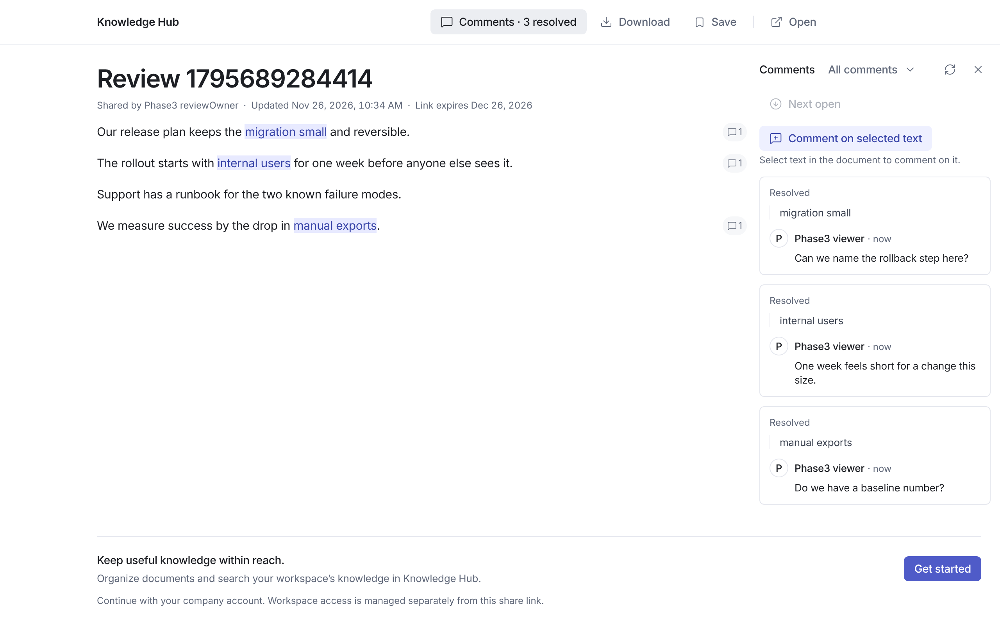 | 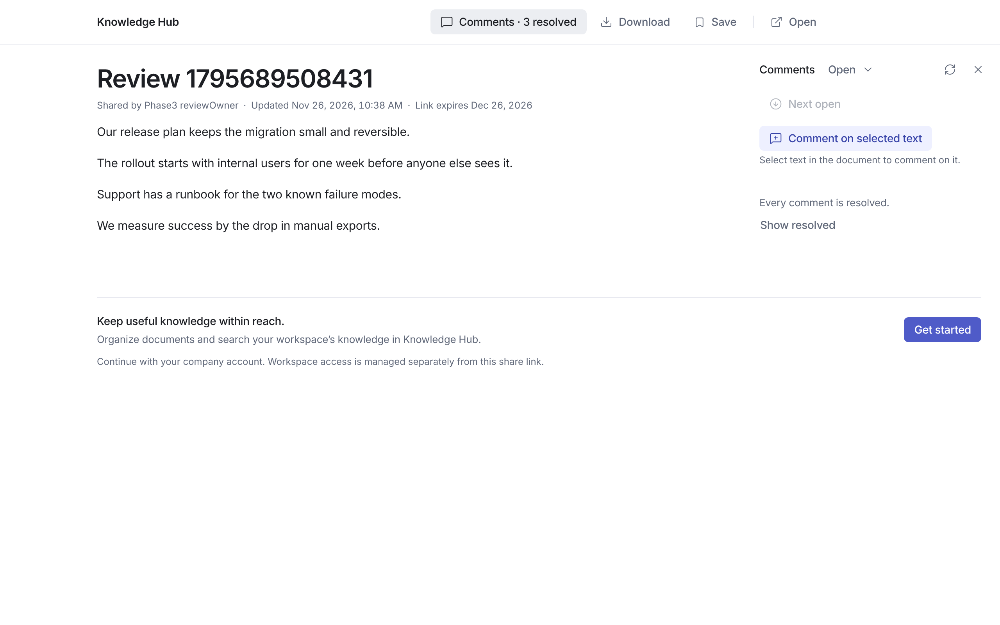 |

## Filter menu (signed-in reader)

| Before | After |
| --- | --- |
|  | 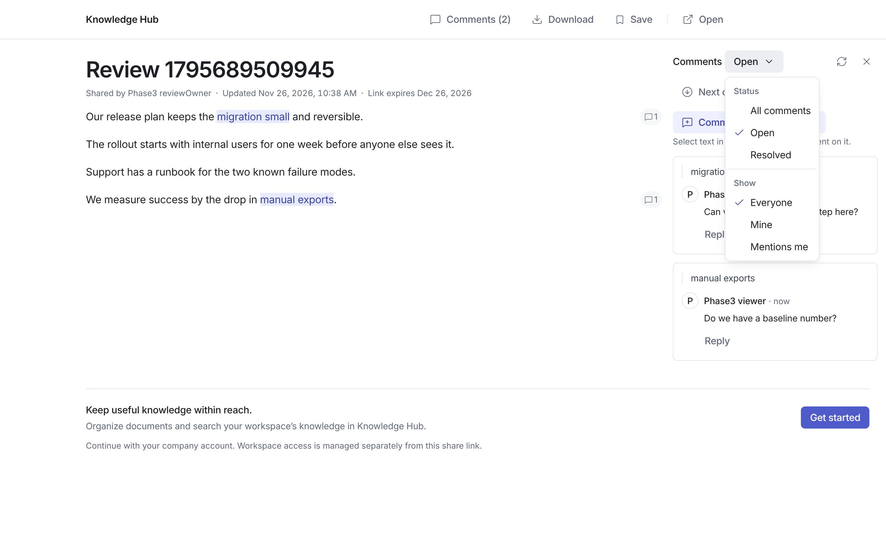 |

## Comment on selected text, hovered

| Before | After |
| --- | --- |
| 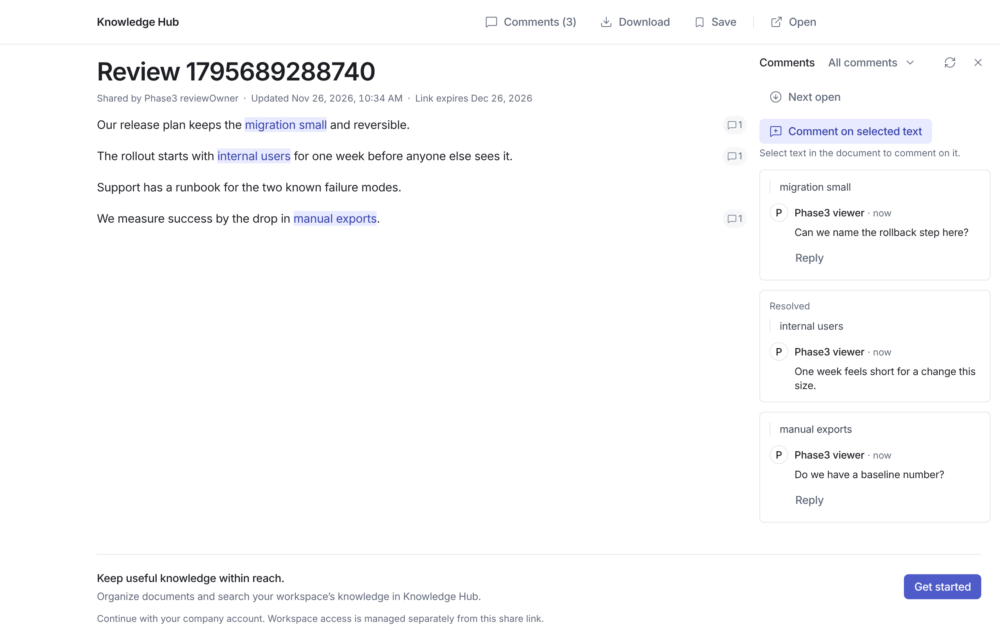 | 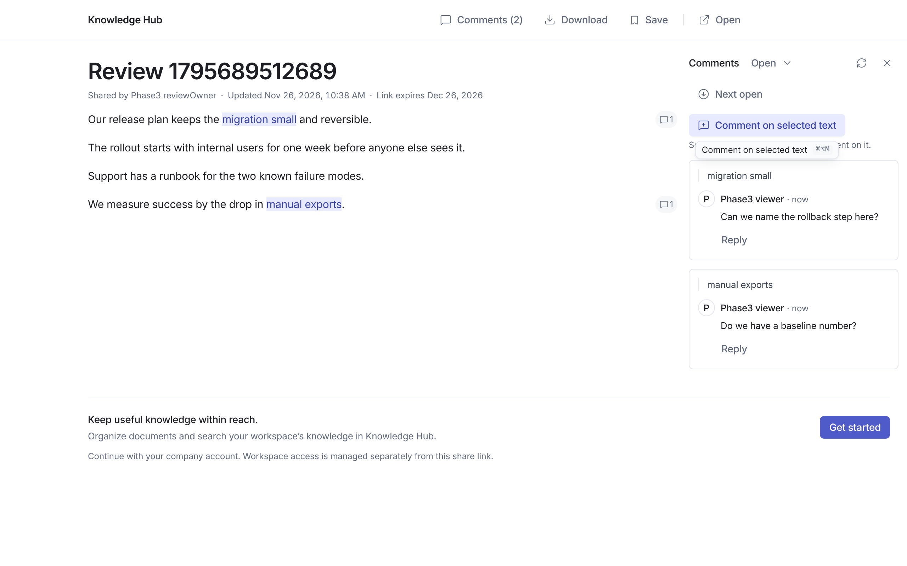 |

## An open card's options (the reader wrote this comment)

The after capture is taken just as the menu opens, so it is still fading in. For a reader who did not write the comment, the menu used to be missing; now it holds Copy link to discussion alone (covered by `tests/e2e/review-copy-link.spec.ts`).

| Before | After |
| --- | --- |
| 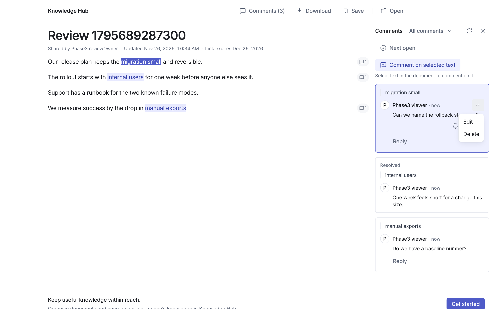 | 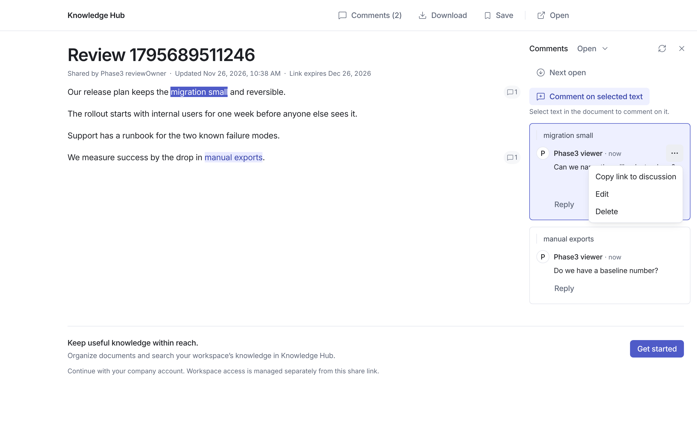 |

After Copy link to discussion (after only; the menu is still fading out as it closes):

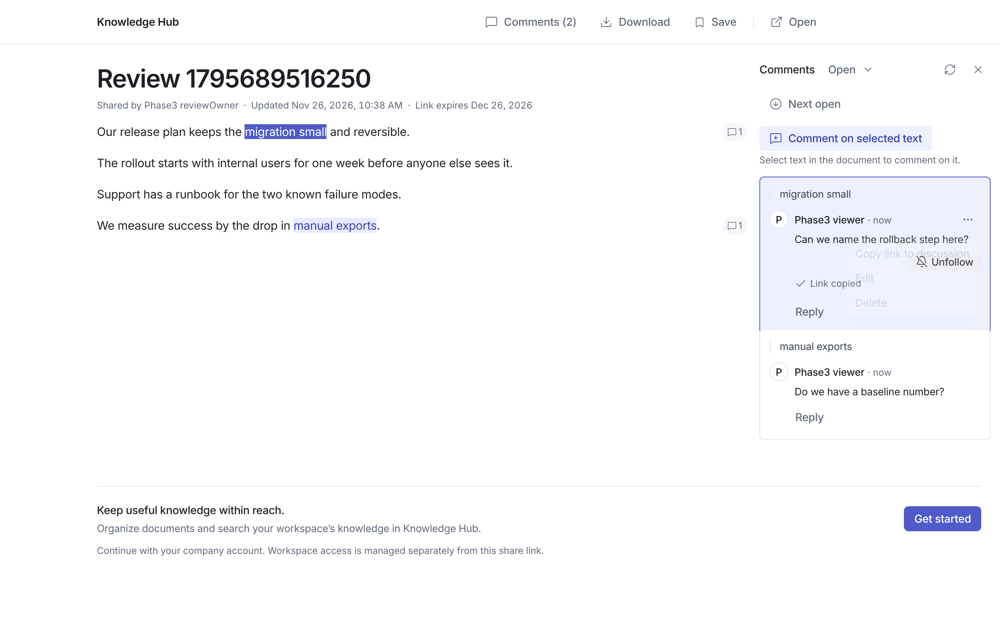

## Shared page, phone 390

| Before | After |
| --- | --- |
| 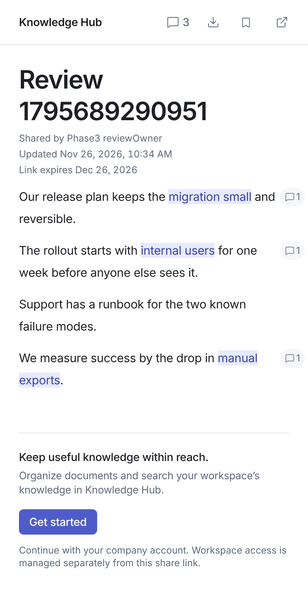 | 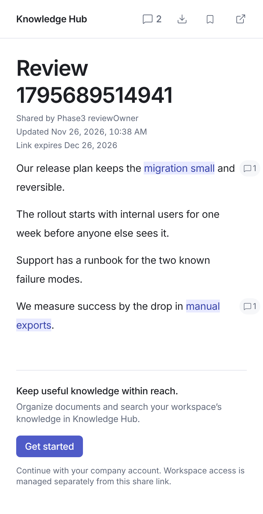 |

## Checks run (on the final branch, 999dde6)

- `npx tsc --noEmit -p .`: clean.
- `npm run lint`: clean.
- `npx vitest run --config vitest.config.ts`: 427 of 428 files, 5785 of 5786 tests pass. The one
  failure, `tests/unit/editor-at-mentions.test.ts` "says so when the pages could not be loaded, and
  the dates still work" (expected `2026-11-26`, got `2026-11-25`), fails the same way on
  `origin/main` and is unrelated to these changes (it depends on the date and time zone).
- `npm run test:integration -- tests/integration/review-mentions.test.ts`: 47 passed.
- E2E: every spec under `tests/e2e` that mentions "comment" (33 files, the two new specs among them:
  `review-comment-shortcut.spec.ts` and `review-copy-link.spec.ts`), through
  `npx tsx scripts/test/e2e.ts … --trace off`: 170 passed, 1 skipped
  (`user-guide-screenshots.spec.ts`, skipped unless screenshots are asked for), 0 failed.
- Each new unit test was run with the `src/` change stashed and failed (see the commit messages).

## After review fixes (465faa8 … the E2E locator commit)

Seven fixes from review: a `?thread=` link to an open discussion keeps Open; AltGr is not the
shortcut; the shortcut is the key that types M (AZERTY); the resolved empty state names the Show
group; the copied link follows the share's audience; the copy-by-hand field keeps focus; the shared
Comments button's name starts with its visible text. No screenshot changed visibly. Re-run:

- `npx tsc --noEmit -p .` and `npm run lint`: clean.
- Full vitest: 5790 passed, 1 failed: the same date-dependent `editor-at-mentions` case that fails
  on `origin/main`.
- `review-mentions` integration: 47 passed.
- All 34 comment-related e2e specs: 171 passed, 1 skipped (`user-guide-screenshots`), 0 failed. A
  first run, before six shared-page locators were moved to the button's new name, had 10 failures:
  9 from those locators, and 1 in `zz-list-commands` (a text selection read "eta" for "beta") that
  passed on the re-run.
