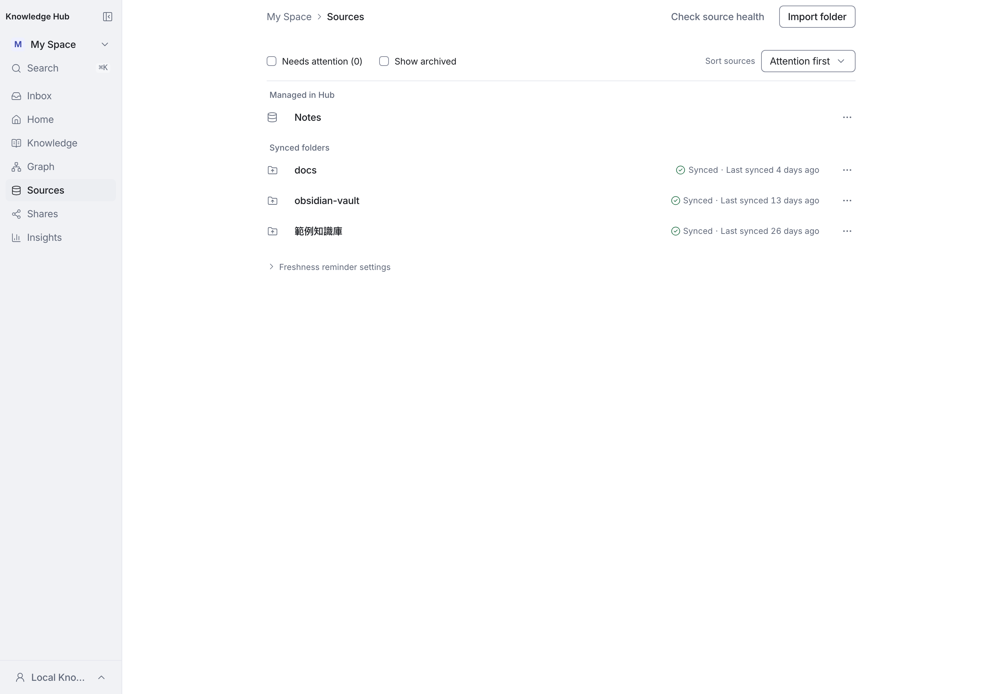

# Sources page source groups

The Sources page separates sources by how their content is managed:

- **Managed in Hub** — Hub-managed sources (`HUB` and `FILE_UPLOAD`).
- **Synced folders** — folder-sync sources.

Both labels are static section headings. They appear only when both groups have
at least one visible source; a filter that empties one group leaves the plain
list. Rows omit the type the group heading already states; `File upload` stays
labelled inside Managed in Hub. When sorting by attention, the group holding an
attention item comes first.

Captured on 2026-11-04 from a production build of `67ddc622` on a local
development database. Viewport 1440 × 1000, light theme, 2× device scale. The
workspace has one Hub source and three folder-sync sources. No production data.

